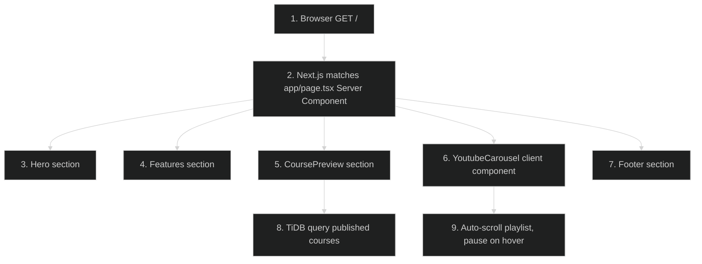

# Homepage Redesign — Feature Flow

Polished sequence/flowchart documentation for the **Homepage redesign** feature (Phase 1.1). Dark-themed Mermaid diagram + step-by-step actions. Understandable without reading code.

---

## Diagram

## Participants

- **Browser / User** — requests `/`, renders HTML.
- **Next.js App Router** — routes to `app/page.tsx` (Server Component, no auth).
- **TiDB** — stores courses (is_published, order_index).
- **YouTube (external)** — playlist embed for carousel.

## Key files

- `app/page.tsx`
- `app/_components/Hero.tsx`
- `app/_components/Features.tsx`
- `app/_components/CoursePreview.tsx`
- `app/_components/YoutubeCarousel.tsx`
- `app/_components/Footer.tsx`

## Step-by-step actions

1. Browser sends `GET /` to Next.js (public route, no auth required — see `proxy.ts` `isPublicRoute`).
2. Next.js matches `app/page.tsx`, a Server Component; no Clerk `auth()` call needed for public page.
3. `Hero` renders headline, CTA buttons (Sign in / Get started), gradient background.
4. `Features` renders 4–6 feature cards with Lucide icons and short descriptions.
5. `CoursePreview` (Server Component) queries TiDB: `SELECT ... FROM courses WHERE is_published = true ORDER BY order_index LIMIT N`.
6. TiDB returns published course rows (title, description, icon, difficulty, category).
7. `CoursePreview` renders course cards linking to `/courses/{id}`.
8. `YoutubeCarousel` is a Client Component: auto-scrolls the playlist on an interval, pauses on hover, resumes on mouse leave.
9. `Footer` renders navigation links and social icons.
10. All sections compose into final HTML streamed to the browser.

## Data flow

- Server Component is the data-fetching boundary; only `CoursePreview` touches TiDB.
- YouTube carousel is the only client component (needs browser timers/events).
- No auth, no rate limiting, no caching beyond Next.js defaults on this route.
- Images/icons served from GitHub URLs / CDN (free-tier safeguard).

## Workflow phases

- **Phase 1 — Request Initiation**: browser GET `/`.
- **Phase 2 — Server Render**: `app/page.tsx` composes sections.
- **Phase 3 — Data Fetch**: `CoursePreview` queries TiDB.
- **Phase 4 — Client Hydration**: `YoutubeCarousel` activates auto-scroll.
- **Phase 5 — Response**: final HTML delivered.

## Conditional branches

- If no published courses exist → `CoursePreview` renders empty state ("No courses yet").
- If JS disabled → carousel static (no auto-scroll), rest of page works.

## Assumptions

- Course preview limit N is hardcoded in `CoursePreview` (not confirmed; verify in code).
- YouTube playlist ID is configured in the component (not a DB value).

---

**Status**: Batch 1 of N. Approve to proceed to the next feature: **Course catalog + chapters**.
