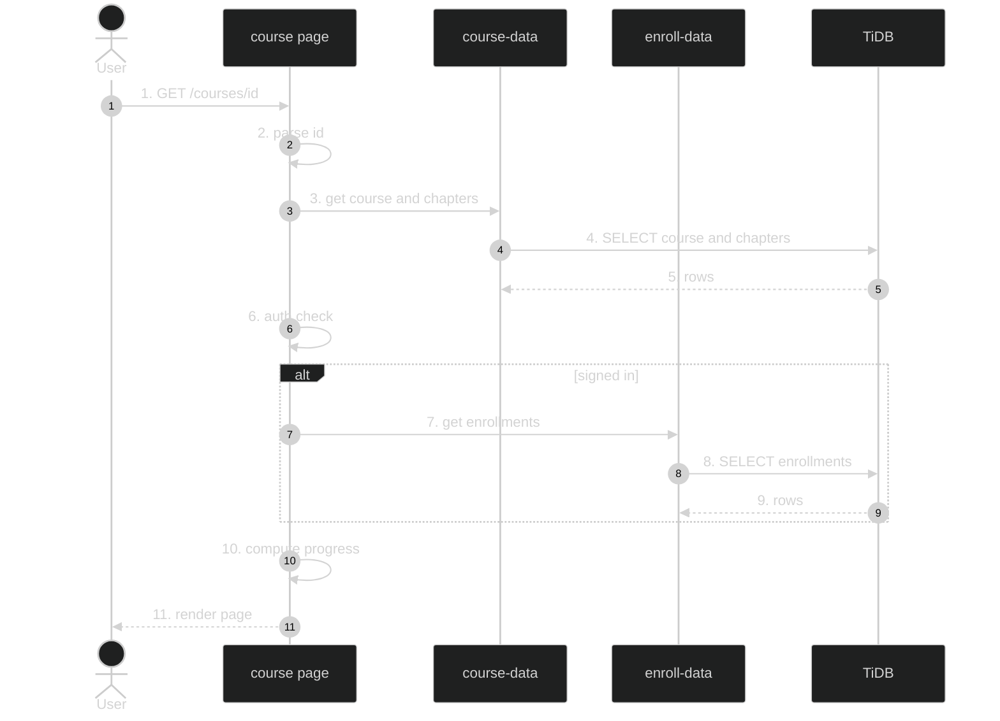

# Course Catalog + Chapters — Feature Flow

Polished sequence/flowchart documentation for the **Course catalog + chapters** feature (Phase 1.2/1.3). Dark-themed Mermaid diagram + step-by-step actions. Understandable without reading code.

---

## Diagram

## Participants

- **User / Browser** — requests course detail page.
- **Next.js Server Component** (`app/(routes)/courses/[id]/page.tsx`) — data-fetching boundary.
- **lib/course-data** — course + chapter queries.
- **lib/enroll-data** — enrollment queries.
- **TiDB** — courses, chapters, enrollments tables.
- **Clerk** — session resolution (optional).

## Key files

- `app/(routes)/courses/[id]/page.tsx`
- `app/(routes)/courses/[id]/ChapterTimeline.tsx`
- `app/(routes)/courses/[id]/EnrollButton.tsx`
- `lib/course-data.ts`
- `lib/enroll-data.ts`
- `lib/parse-id.ts`

## Step-by-step actions

1. Browser sends `GET /courses/{id}` (authenticated route group; Clerk middleware allows signed-out too, page handles both).
2. Page awaits `params` Promise, extracts `id`, calls `parsePositiveInt(id)`; if invalid calls `notFound()` (404 page).
3. Calls `getCourseById(id)` and `getChaptersByCourseId(id)` from `lib/course-data`.
4. Drizzle executes `SELECT id,title,description,icon,difficulty,category FROM courses WHERE id=?` and `SELECT id,title,order_index,points_reward FROM chapters WHERE course_id=? ORDER BY order_index` against TiDB.
5. TiDB returns the course row and chapter list; if course is null, `notFound()`.
6. Clerk `auth()` resolves `userId` (null if signed out).
7. If signed in, calls `getEnrollmentsByClerkId(userId)` -> `SELECT ... FROM enrollments WHERE user_id=?`.
8. TiDB returns enrollment rows with JSON `progress`.
9. Finds the enrollment for this course.
10. Computes: `completedIds` = Set of `progress.completedChapters`; `completedCount` = chapters filtered by completedIds; `isEnrolled` = !!enrollment; `courseComplete` = isEnrolled && chapters.length>0 && completedCount===chapters.length; `pct` = round(completedCount/chapters.length*100); `resumeHref` = enrollment.nextChapterId ? `/learn/{id}/{nextChapterId}` : `/learn/{id}/{chapters[0].id}`.
11. Renders: hero card (title, difficulty badge, icon, points), ChapterTimeline with completed ticks, and EnrollButton if not enrolled OR Resume button + progress bar + % if enrolled.

## Data flow

- Parallel-ish course + chapter queries (both awaited; enrollment only when signed in).
- Progress JSON (`completedChapters`, `currentChapter`, `nextChapterId`) drives the timeline and resume link.
- No mutation on this page; enrollment/progress writes happen via API routes.

## Workflow phases

- **Phase 1 — Request Initiation**: browser GET `/courses/{id}`.
- **Phase 2 — Data Fetch**: course + chapters (+ enrollment if signed in).
- **Phase 3 — Computation**: progress derived from enrollment JSON.
- **Phase 4 — Render**: hero, timeline, enroll/resume UI.

## Conditional branches

- `[Signed in]` / `[Signed out]`: enrollment query skipped when signed out; EnrollButton shown.
- `[No chapters]`: renders empty state "No chapters available yet. Check back soon!".
- `[Course not found]`: `notFound()` → 404 page.

## Assumptions

- `getChaptersByCourseId` orders by `order_index` (confirmed by pattern; verify column name).
- Points total computed client-side via `totalPoints(chapters)` reduce over `points_reward`.

---

**Status**: Feature 2 of N. Approve to proceed to the next feature: **Code editor**.
