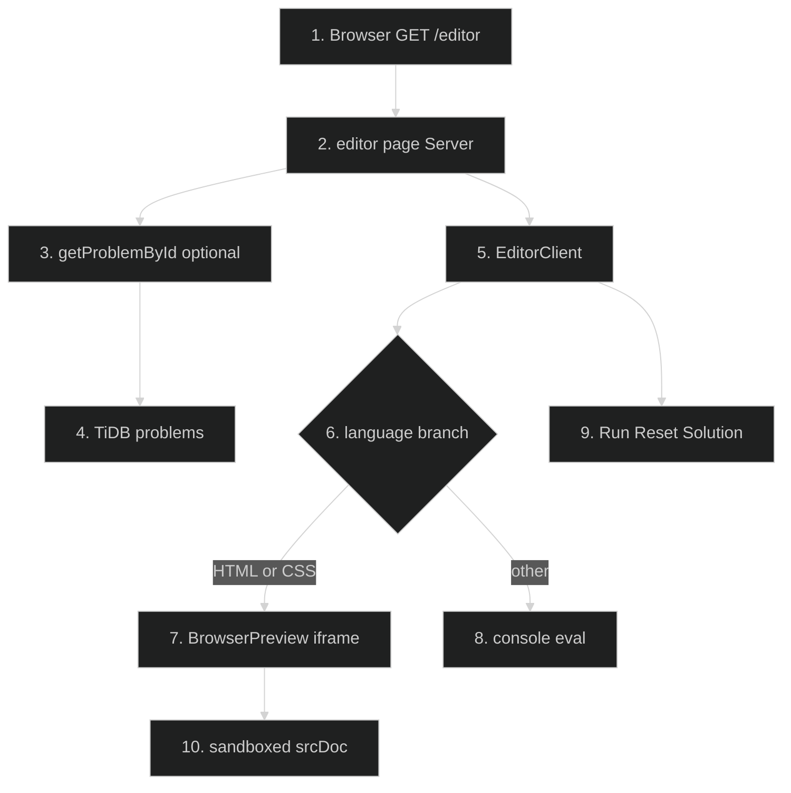

# Code Editor — Feature Flow

Polished sequence/flowchart documentation for the **Code editor** feature (Phase 1.4). Dark-themed Mermaid diagram + step-by-step actions. Understandable without reading code.

---

## Diagram

## Participants

- **User / Browser** — opens editor, writes code, clicks Run/Reset/Solution.
- **Next.js Server Component** (`app/(routes)/editor/page.tsx`) — loads optional problem.
- **lib/problem-data** — problem fetch.
- **TiDB** — problems table (title, description, difficulty, initial_code JSON, solution).
- **EditorClient (client)** — state + execution.
- **BrowserPreview (client)** — sandboxed iframe for HTML/CSS.

## Key files

- `app/(routes)/editor/page.tsx`
- `app/(routes)/editor/EditorClient.tsx`
- `app/(routes)/editor/EditorWorkspace.tsx`
- `lib/editor.ts`
- `components/editor/BrowserPreview.tsx`
- `tests/editor.test.ts`

## Step-by-step actions

1. Browser sends `GET /editor?problemId=N` (authenticated route group).
2. Server page awaits `searchParams`, extracts `problemId`.
3. If `problemId` present, calls `getProblemById(Number(problemId))` -> `SELECT ... FROM problems WHERE id=N`.
4. TiDB returns problem (title, description, difficulty, `initial_code` JSON, solution) or null.
5. Renders `EditorClient` with `key=problem?.id ?? "playground"` (remounts on problem change), passing `problem` prop.
6. Client state holds `code`, `language`, `output`, `running` flag.
7. Language branch: HTML/CSS → BrowserPreview; JS/TS/Python/etc → console eval runner.
8. BrowserPreview builds sandboxed `srcDoc` via `lib/editor.ts` (injects code) and renders in iframe with `sandbox="allow-scripts"` (no `allow-same-origin`).
9. Console eval runs code and captures `console.log`/errors into the output panel.
10. Run button executes code; Reset restores `initial_code`; Show solution displays solution text.

## Data flow

- Server loads optional problem; client editor manages all interactive state.
- HTML/CSS runs in a sandboxed iframe (security boundary is the iframe attribute, not unit-tested — see `tests/editor.test.ts` note).
- Other languages run via in-browser console eval (no server execution).
- No DB writes on this page (read-only problem fetch).

## Workflow phases

- **Phase 1 — Request Initiation**: browser GET `/editor`.
- **Phase 2 — Data Fetch**: optional problem load from TiDB.
- **Phase 3 — Client Render**: EditorClient + language branch.
- **Phase 4 — Execution**: sandboxed preview or console eval.
- **Phase 5 — Interaction**: Run / Reset / Show solution.

## Conditional branches

- `[problemId present]` / `[no problemId]`: playground mode with no problem.
- `[HTML/CSS]` → sandboxed iframe preview.
- `[JS/TS/other]` → console eval runner.
- `[problem not found]`: renders editor with no problem (graceful).

## Assumptions

- `initial_code` is a JSON object keyed by language (e.g., `{ javascript: "...", python: "..." }`) — verify shape in `lib/problem-data`.
- Console eval uses `eval`/`Function` in-browser; no server-side execution or test validation (Run-only, per tracker).

---

**Status**: Feature 3 of N. Approve to proceed to the next feature: **Progress system** (Phase 1.6).
