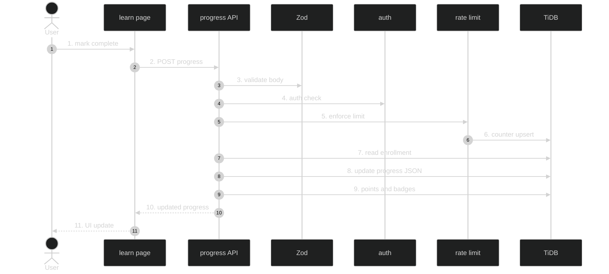

# Progress System — Feature Flow

Polished sequence/flowchart documentation for the **Progress system** feature (Phase 1.6). Dark-themed Mermaid diagram + step-by-step actions. Understandable without reading code.

---

## Diagram

## Participants

- **User / Browser** — clicks "Mark complete" or auto-complete on run success.
- **learn page (client)** — `learn/[courseId]/[chapterId]`.
- **POST /api/progress** — handler.
- **Zod** — body validation.
- **Clerk auth()** — session resolution.
- **DB rate limit** — `lib/db-rate-limit.ts` (10/min, progress scope).
- **TiDB** — enrollments (progress JSON), badges, users (points).

## Key files

- `app/api/progress/route.ts`
- `lib/enroll-data.ts`
- `lib/db-rate-limit.ts`
- `config/rate-limits.ts`
- `config/schema.tsx` (enrollments.progress JSON, badges, users.points)

## Step-by-step actions

1. User clicks "Mark complete" or auto-complete triggers on run success.
2. Client POSTs `{ courseId, chapterId }` to `/api/progress`.
3. Zod validates body: `courseId` positive int, `chapterId` positive int; 400 with details on failure.
4. Clerk `auth()` resolves `userId`; 401 if null.
5. `enforceDbRateLimit(userId, "progress", pathname, "POST")` (limit 10 per 60s).
6. Atomic counter upsert in `rate_limits` table; 429 if over limit.
7. `SELECT enrollment WHERE user_id=? AND course_id=?`; 404/403 if none.
8. `UPDATE enrollments SET progress = JSON` appending chapterId to completedChapters, recomputing currentChapter and nextChapterId.
9. If all chapters complete: insert badge (course_complete) if not exists; increment `users.points` by course points.
10. Returns 200 with updated progress JSON, pointsEarned, badge.
11. Client updates local state: chapter tick, stars animation, points toast, progress bar; confetti on course complete.

## Data flow

- Completion writes to the enrollment's JSON `progress` (completedChapters, currentChapter, nextChapterId).
- Points/badges derived from completion.
- Rate-limited per user (10/min).

## Workflow phases

- **Phase 1 — Request Initiation**: user marks chapter complete.
- **Phase 2 — Authentication & Validation**: Zod + Clerk + rate limit.
- **Phase 3 — Persistence**: enrollment progress update + points/badges.
- **Phase 4 — Response & State Update**: 200 + client UI update.

## Conditional branches

- `[Validation fails]` → 400 with details.
- `[Unauthenticated]` → 401.
- `[Rate limited]` → 429 with retry-after.
- `[No enrollment]` → 404/403.
- `[Course complete]` → badge insert + points increment + confetti.

## Assumptions

- `nextChapterId` recompute logic lives in the handler (verify which chapter is "next" after current).
- Points per course = sum of chapter `points_reward` (verify in handler).

---

**Status**: Feature 4 of N. Approve to proceed to the next feature: **Enrollment flow** (Phase 1.7).
