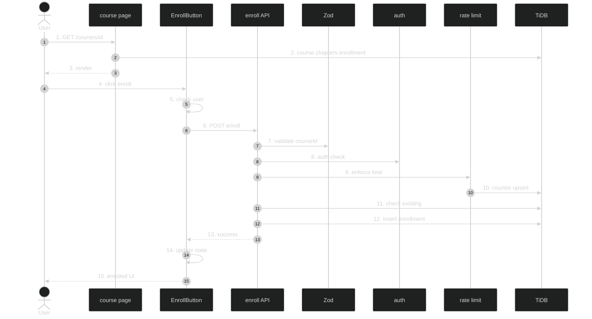

# Enrollment Flow — Feature Flow

Polished sequence/flowchart documentation for the **Enrollment flow** feature (Phase 1.7). Dark-themed Mermaid diagram + step-by-step actions.

---

## Diagram

## Participants

- User / Browser, Course page (Server Component), EnrollButton (client), POST /api/enroll, Zod, Clerk, DB rate limit, TiDB enrollments.

## Key files

- `app/(routes)/courses/[id]/EnrollButton.tsx`
- `app/api/enroll/route.ts`
- `lib/enroll-data.ts`
- `lib/db-rate-limit.ts`
- `config/rate-limits.ts`

## Step-by-step actions

1. Browser requests `/courses/{id}`.
2. Page queries course, chapters, and enrollment (if signed in).
3. Renders EnrollButton when not enrolled, else Resume button + progress.
4. User clicks "Enroll Now".
5. Client checks `useUser()`; if no user, redirects to `/sign-in` and stops.
6. Otherwise sets loading, disables button, shows spinner, POSTs `{ courseId }` to `/api/enroll`.
7. Zod validates `{ courseId: positive int }`; 400 on failure.
8. Clerk `auth()` resolves `userId`; 401 if null.
9. Rate limit check (5 per 60s for enroll scope).
10. Atomic counter upsert; 429 if over limit.
11. Checks for existing enrollment; 409 if already enrolled.
12. Inserts enrollment row with `progress = { completedChapters: [], currentChapter: firstChapterId, nextChapterId: firstChapterId }`, `started_at = NOW()`.
13. Returns 200/201 success.
14. Client sets enrolled state, shows success toast, stops spinner.
15. Button becomes "Enrolled" (disabled, checkmark); page refresh shows Resume button.

## Data flow

- Client button POSTs; handler validates (Zod) + authenticates + rate-limits; Drizzle inserts enrollment with JSON progress; UI updates on success.

## Workflow phases

- Phase 1 — Request Initiation: page load + click.
- Phase 2 — Authentication & Validation: Zod + Clerk + rate limit.
- Phase 3 — Persistence: enrollment insert.
- Phase 4 — Response & State Update: client UI update.

## Conditional branches

- `[No user]` → redirect to `/sign-in`.
- `[Validation fails]` → 400.
- `[Unauthenticated]` → 401.
- `[Rate limited]` → 429.
- `[Already enrolled]` → 409.

## Assumptions

- `firstChapterId` derived from first chapter by `order_index` (verify in handler).
- No badge/points on enrollment (only on completion).

---

**Status**: Feature 5 of N.
