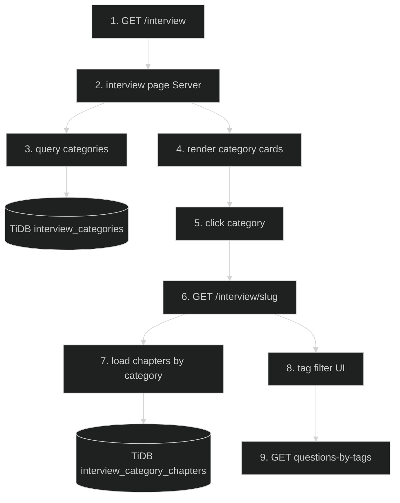

# Interview Categories & Tag System — Feature Flow

Polished documentation for **Interview categories + Tag system** (Phase 2.1/2.2). Dark-themed Mermaid + step-by-step actions.

## Diagram

## Key files

- `app/(routes)/interview/page.tsx`
- `app/(routes)/interview/[category]/page.tsx`
- `app/(routes)/interview/[category]/ChapterHubClient.tsx`
- `lib/interview-data.ts`
- `config/schema.tsx` (interview_categories, tags, interview_question_chapters)

## Step-by-step actions

1. Browser requests `/interview` (public-ish authenticated route).
2. Server page queries `interview_categories` (name, slug, description, icon).
3. TiDB returns category list; renders color-coded cards (hero redesign style).
4. User clicks a category → navigates to `/interview/{slug}`.
5. Category page loads chapters via `interview_category_chapters` (chapter list for that category).
6. Renders left sidebar chapter nav + right content (docs layout).
7. Tag filter UI lists tags (Angular, Spring Boot, React, etc.).
8. Selecting tags calls `GET /api/interview/questions-by-tags?tags=...` (rate-limited 10/min).
9. Handler validates tags (Zod), authenticates, queries questions linked to those tags via `interview_question_chapters`, returns filtered list.

## Data flow

- Category → chapters → questions chain (a question reaches a category only through `interview_question_chapters`; 130/1078 questions are orphaned/unreachable — see Known Debt).
- Tags stored as JSON array on `interview_questions.tags`.

## Conditional branches

- `[No chapters]` → empty state.
- `[Tag filter empty]` → returns all questions for category.

## Assumptions

- Tag matching is exact string match against JSON array (verify in API).
- Question bank counts: "1000+" is bank size, not browsable size.

---

**Status**: Feature 6 of N.
