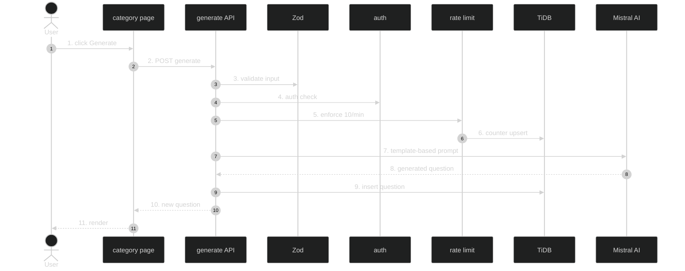

# Question Generation — Feature Flow

Polished documentation for **Question generation** (Phase 2.3). Template-based AI generation endpoint.

## Diagram

## Key files

- `app/api/interview/generate/route.ts`
- `app/(routes)/interview/[category]/ChapterHubClient.tsx` (Generate button)
- `lib/interview-data.ts`
- `config/rate-limits.ts`

## Step-by-step actions

1. User clicks "Generate" button on category page.
2. Client POSTs to `/api/interview/generate` with category/tags/difficulty.
3. Zod validates input (category slug, tags array, difficulty enum).
4. Clerk `auth()` resolves `userId`; 401 if null.
5. Rate limit check (10 per 60s, generate scope).
6. Atomic counter upsert; 429 if over.
7. Build template-based prompt (category context + tags + difficulty) and call Mistral AI.
8. Mistral returns generated question + answer text.
9. Insert into `interview_questions` (question, answer, difficulty, tags JSON, is_top50=false) and link to category via `interview_question_chapters`.
10. Returns 200 with new question.
11. Client prepends question to list / shows success.

## Data flow

- Template-based AI (not free-form) to constrain output shape.
- Rate-limited to control Mistral spend.

## Conditional branches

- `[Validation fails]` → 400.
- `[Unauthenticated]` → 401.
- `[Rate limited]` → 429.
- `[AI error]` → 500 (logged).

## Assumptions

- Prompt template lives in the route or `lib/mentor`-style helper (verify).
- Generated questions default `is_top50=false`.

---

**Status**: Feature 7 of N.
