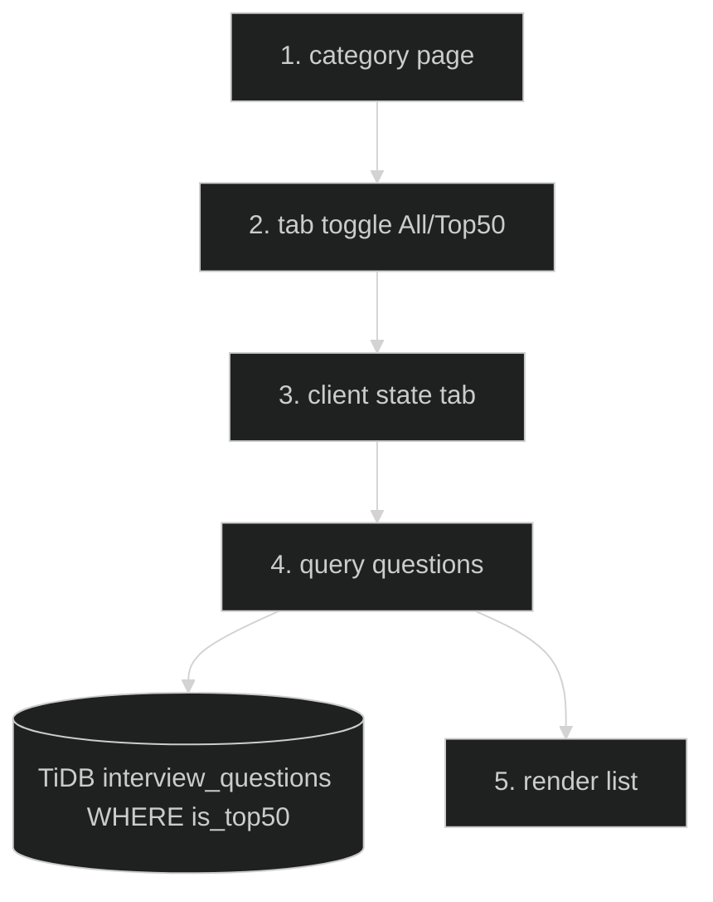

# Top 50 Questions — Feature Flow

Documentation for **Top 50 questions** toggle (Phase 2.4).

## Diagram

## Key files

- `app/(routes)/interview/[category]/ChapterHubClient.tsx` (tab toggle)
- `lib/interview-data.ts`

## Step-by-step actions

1. Category page renders two tabs: "All" and "Top 50".
2. Client state tracks active tab.
3. On tab switch, query questions with `is_top50` filter when Top 50 selected.
4. Drizzle `SELECT ... FROM interview_questions WHERE is_top50 = true` (joined via `interview_question_chapters` for category).
5. TiDB returns filtered list; renders QuestionCards.

## Data flow

- `is_top50` boolean column drives the toggle; no separate endpoint.

## Conditional branches

- `[No top-50 questions]` → empty state.

## Assumptions

- Top 50 flag set during seed (25K+ line seed data).

---

**Status**: Feature 8 of N.
