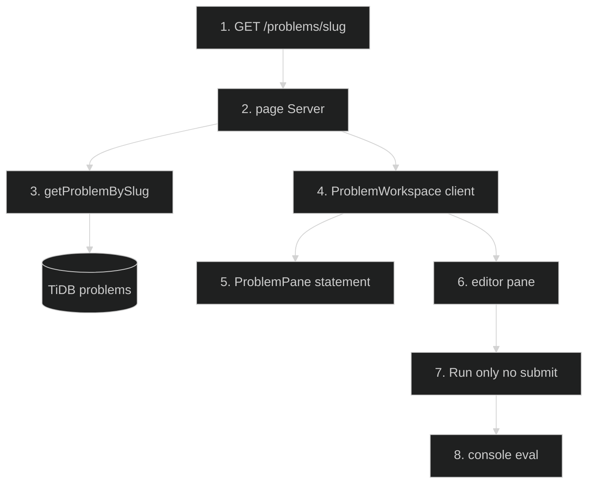

# Problem Solving Workspace — Feature Flow

Documentation for **Problem solving list / unified workspace** (Phase 2.5): `/problems/[slug]` split-pane.

## Diagram

## Key files

- `app/(routes)/problems/[slug]/page.tsx`
- `app/(routes)/problems/[slug]/ProblemWorkspace.tsx`
- `app/(routes)/problems/[slug]/_components/ProblemPane.tsx`
- `app/(routes)/problems/[slug]/_components/ProblemBrowser.tsx`
- `lib/problem-data.ts`

## Step-by-step actions

1. Browser requests `/problems/{slug}`.
2. Server page loads problem by slug via `getProblemBySlug` (Drizzle SELECT problems WHERE slug=?).
3. TiDB returns problem (title, description, difficulty, category, initial_code JSON, solution).
4. Renders `ProblemWorkspace` client with problem prop.
5. Left pane (`ProblemPane`) shows statement, constraints, examples.
6. Right pane shows code editor (reuses editor component) with language selector.
7. "Run" executes code against sample tests (console eval); no submit/judge (Run-only).
8. Output panel shows stdout/stderr and pass/fail per sample.
9. Reset restores initial_code; Show solution displays reference.

## Data flow

- Read-only problem fetch; execution is client-side (console eval), no server judge.
- 36 in-house Basic drills + 183 top LeetCode problems seeded.

## Conditional branches

- `[slug not found]` → 404.
- `[run error]` → stderr shown, no crash.

## Assumptions

- Sample tests are embedded in problem description/JSON (verify shape).
- No persistence of user code (no DB write) — ephemeral.

---

**Status**: Feature 9 of N.
