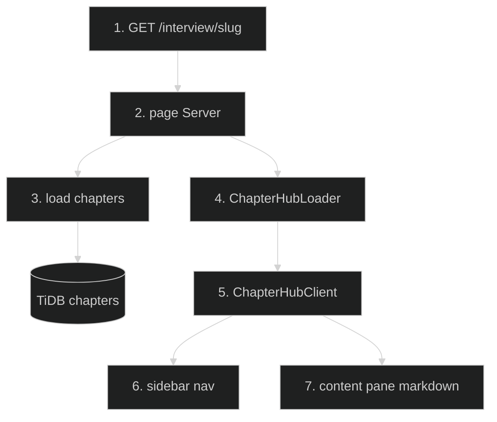

# Interview Docs Layout — Feature Flow

Documentation for **Interview docs layout** (Phase 2.6): left sidebar chapter nav + right content.

## Diagram

## Key files

- `app/(routes)/interview/[category]/page.tsx`
- `app/(routes)/interview/[category]/ChapterHubLoader.tsx`
- `app/(routes)/interview/[category]/ChapterHubClient.tsx`
- `app/(routes)/interview/[category]/QuestionCard.tsx`

## Step-by-step actions

1. Browser requests `/interview/{category}`.
2. Server page loads category + its chapters.
3. `ChapterHubLoader` fetches chapter content (markdown + code examples).
4. `ChapterHubClient` renders two-pane layout: left sidebar (chapter list, active highlight) + right content.
5. Content pane renders markdown via react-markdown + highlight.js (code blocks, scenarios, deep dives).
6. Clicking a chapter in sidebar swaps content pane (client state, no full reload).
7. QuestionCard components render Q&A within content.

## Data flow

- Chapter content stored in `interview_category_chapters` (markdown text + code).
- Client-side navigation between chapters (no server round-trip).

## Conditional branches

- `[No chapters]` → empty state.
- `[Deep link to chapter]` → renders that chapter (verify via query param).

## Assumptions

- Chapter content is markdown stored in DB (not static files).

---

**Status**: Feature 10 of N.
