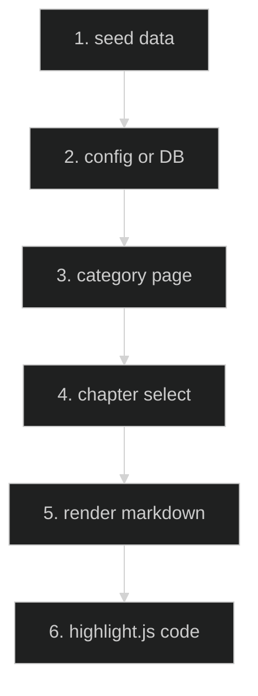

# Interview Chapter Notes — Feature Flow

Documentation for **Interview chapter notes** (Phase 2.7): 15 chapters across 6 categories with markdown rendering.

## Diagram

## Key files

- `app/(routes)/interview/[category]/page.tsx`
- `config/` (interview seed data, 25K+ lines)
- `app/(routes)/interview/[category]/ChapterHubClient.tsx`

## Step-by-step actions

1. Seed data (25K+ lines) populates chapters across 6 categories (FE, BE, Fullstack, DevOps, QA, etc.).
2. Category page lists chapters with titles/order.
3. User selects a chapter → content pane renders.
4. react-markdown renders markdown body (headings, lists, tables).
5. highlight.js (via rehype) syntax-highlights code blocks.
6. Real-life scenarios, deep dives, code examples displayed.

## Data flow

- Chapter content from DB (seeded); rendered client-side with markdown libs.

## Conditional branches

- `[No content]` → placeholder.

## Assumptions

- Markdown stored in DB column (verify column name in schema).

---

**Status**: Feature 11 of N.
