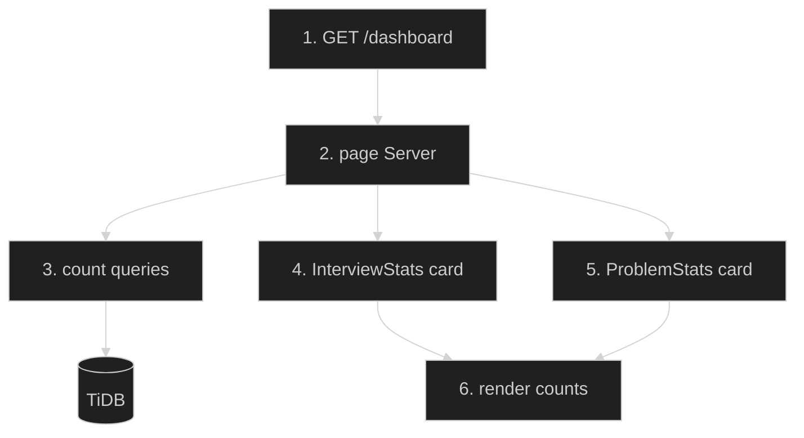

# Dashboard Stats Cards — Feature Flow

Documentation for **Dashboard stats cards** (Phase 2.8): Interview Prep + Problem Solving live counts.

## Diagram

## Key files

- `app/(routes)/dashboard/page.tsx`
- `app/(routes)/dashboard/_components/InterviewStats.tsx`
- `app/(routes)/dashboard/_components/ProblemStats.tsx`
- `lib/interview-data.ts`, `lib/problem-data.ts`

## Step-by-step actions

1. Browser requests `/dashboard` (authenticated).
2. Server page runs count queries: interview questions total, problems total, plus user progress.
3. TiDB returns counts (indexed columns).
4. `InterviewStats` card renders interview prep count + progress.
5. `ProblemStats` card renders problem solving count + solved count.
6. Other dashboard sections (WelcomeBanner, ContinueLearning, EnrolledCourses, QuickActions, DailyTip, StatusStrip) render.

## Data flow

- Server Component fetches all dashboard data; client components display.

## Conditional branches

- `[No enrolled courses]` → empty state in EnrolledCourses.
- `[No progress]` → 0% shown.

## Assumptions

- Counts are `COUNT(*)` queries (verify against `COUNT(DISTINCT ...)` for reachability).

---

**Status**: Feature 12 of N.
