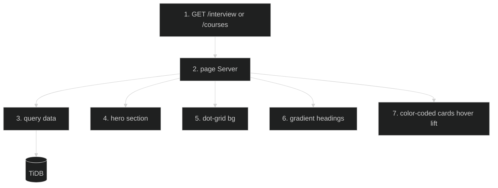

# Pages Redesign — Feature Flow

Documentation for **Pages redesign** (Phase 2.9): Interview listing and Courses page hero/dot-grid/gradient redesign.

## Diagram

## Key files

- `app/(routes)/interview/page.tsx`
- `app/(routes)/courses/page.tsx`

## Step-by-step actions

1. Browser requests `/interview` or `/courses`.
2. Server page queries categories/courses.
3. TiDB returns rows.
4. Renders hero section (title, subtitle, gradient).
5. Dot-grid background (`bg-grid-paper`) applied.
6. Gradient headings via Tailwind.
7. Color-coded cards (difficulty/category based) with hover lift (translate-y + shadow).
8. Responsive layout (mobile/tablet/desktop).

## Data flow

- Purely presentational redesign; data queries unchanged.

## Assumptions

- Color mapping by difficulty/category (verify class helpers).

---

**Status**: Feature 13 of N.
