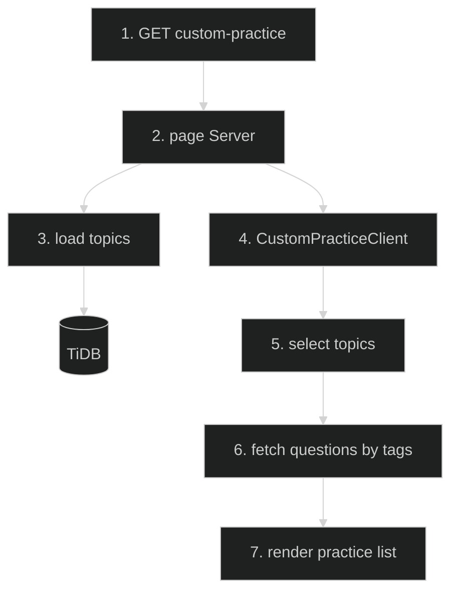

# Custom Practice — Feature Flow

Documentation for **Custom practice page** (Phase 2.11): `/interview/[category]/custom-practice`.

## Diagram

## Key files

- `app/(routes)/interview/[category]/custom-practice/page.tsx`
- `app/(routes)/interview/[category]/custom-practice/CustomPracticeClient.tsx`
- `app/api/interview/questions-by-tags/route.ts`

## Step-by-step actions

1. Browser requests `/interview/{category}/custom-practice`.
2. Server page loads category + available topics/tags.
3. TiDB returns tags.
4. `CustomPracticeClient` renders topic selector (checkboxes).
5. User selects topics → calls `GET /api/interview/questions-by-tags?tags=...`.
6. Handler validates, authenticates, rate-limits (10/min), queries questions linked to selected tags.
7. Returns filtered questions; client renders practice list with answers revealed on click.

## Data flow

- Tag-based filtering via `questions-by-tags` API.

## Conditional branches

- `[No topics selected]` → prompt to select.
- `[No questions]` → empty state.

## Assumptions

- Topic list derived from distinct tags in category (verify).

---

**Status**: Feature 14 of N.
