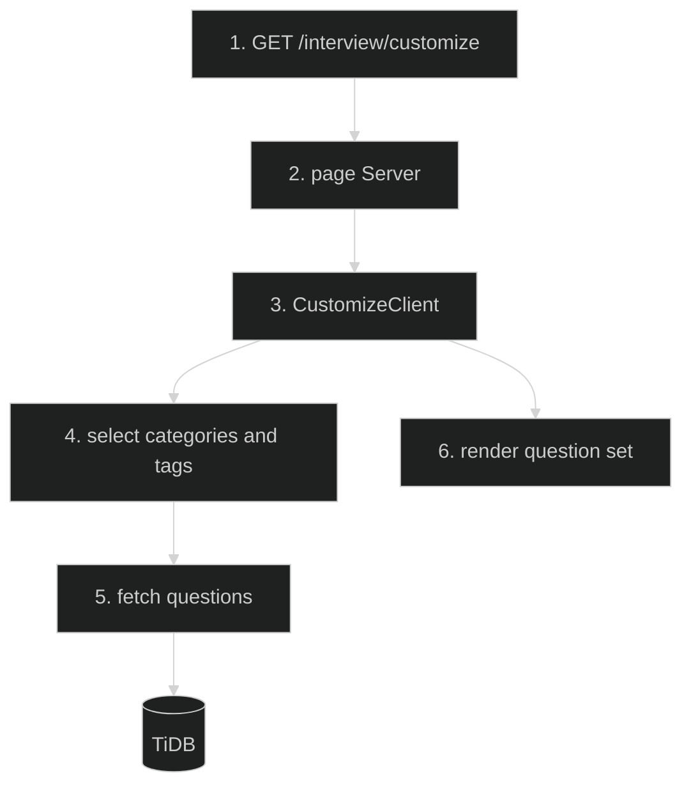

# Interview Customize — Feature Flow

Documentation for **Interview customize page** (Phase 2.12): `/interview/customize`.

## Diagram

## Key files

- `app/(routes)/interview/customize/page.tsx`
- `app/(routes)/interview/customize/CustomizeClient.tsx`

## Step-by-step actions

1. Browser requests `/interview/customize`.
2. Server page renders `CustomizeClient`.
3. User selects categories + tags + difficulty.
4. Client fetches questions via questions-by-tags API (or direct query).
5. TiDB returns matching questions.
6. Renders customized question set for practice.

## Data flow

- Client-driven filtering; no persistence of custom sets (ephemeral).

## Conditional branches

- `[No selection]` → show all.

## Assumptions

- Custom sets are not saved (no DB table for saved sets) — verify.

---

**Status**: Feature 15 of N.
