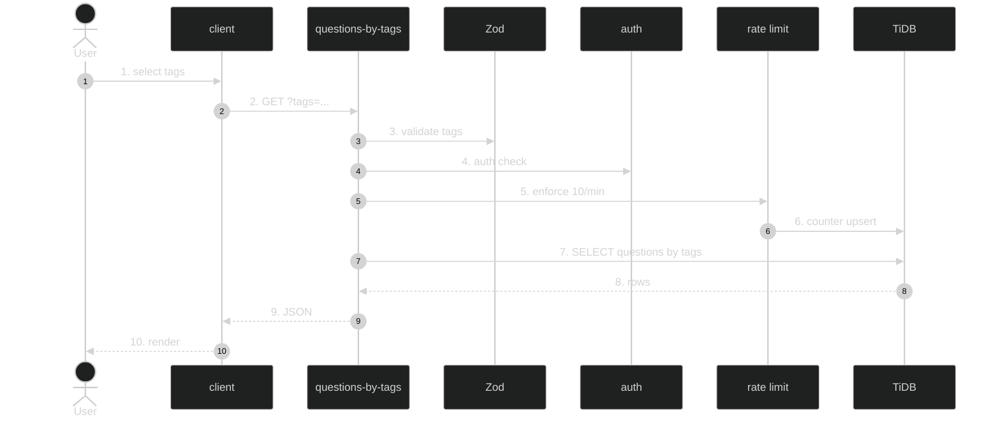

# Questions-by-Tags API — Feature Flow

Documentation for **Questions-by-tags API** (Phase 2.13): `GET /api/interview/questions-by-tags`.

## Diagram

## Key files

- `app/api/interview/questions-by-tags/route.ts`
- `lib/interview-data.ts`
- `config/rate-limits.ts`

## Step-by-step actions

1. Client calls `GET /api/interview/questions-by-tags?tags=react,angular`.
2. Zod validates `tags` query param (array of strings).
3. Clerk `auth()` resolves `userId`; 401 if null.
4. Rate limit check (10 per 60s).
5. Atomic counter upsert; 429 if over.
6. Drizzle queries questions whose `tags` JSON contains any of the provided tags, joined via `interview_question_chapters` for category scoping if applicable.
7. TiDB returns matching questions.
8. Returns 200 `{ questions: [...] }`.
9. Client renders filtered list.

## Data flow

- Tag matching against JSON column; rate-limited.

## Conditional branches

- `[No tags]` → 400 or returns all (verify).
- `[No matches]` → empty array.

## Assumptions

- Tag matching uses JSON_CONTAINS or in-memory filter (verify in code).

---

**Status**: Feature 16 of N.
