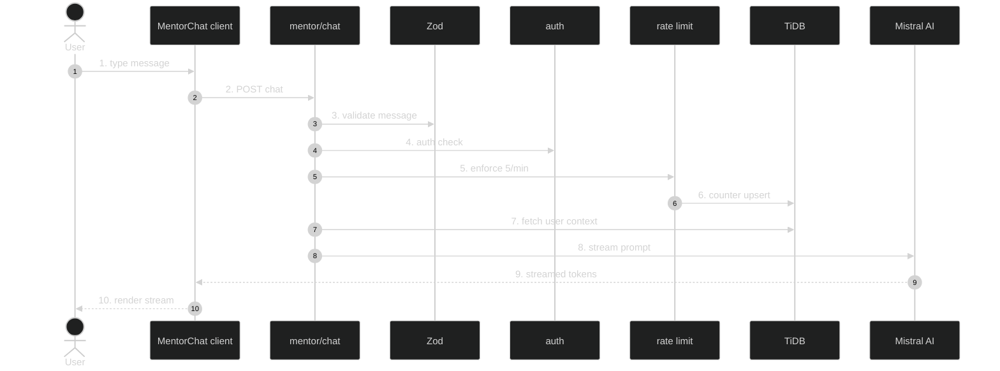

# AI Mentor Chat — Feature Flow

Documentation for **AI Mentor chat** (Phase 3.3): Mistral AI streaming chat with user context.

## Diagram

## Key files

- `app/(routes)/mentor/page.tsx`
- `app/(routes)/mentor/_components/MentorChat.tsx`
- `app/api/mentor/chat/route.ts`
- `lib/mentor.ts`
- `config/rate-limits.ts`

## Step-by-step actions

1. User types message in `MentorChat` client component.
2. Client POSTs to `/api/mentor/chat` with message + history.
3. Zod validates message (non-empty, max length).
4. Clerk `auth()` resolves `userId`; 401 if null.
5. Rate limit check (5 per 60s, mentor-chat scope).
6. Atomic counter upsert; 429 if over.
7. `lib/mentor.ts` fetches user context: skills, course progress (completedChapters), experience level.
8. Builds system prompt (assess level, recommend paths, encourage) + user message.
9. Calls Mistral AI with streaming enabled.
10. Streams tokens back to client via SSE/ReadableStream.
11. Client renders tokens incrementally; shows typing indicator.

## Data flow

- Streaming response (not buffered); user context injected into prompt.
- Rate-limited to control Mistral spend (5/min).

## Conditional branches

- `[Validation fails]` → 400.
- `[Unauthenticated]` → 401.
- `[Rate limited]` → 429.
- `[AI error]` → 500 (logged).

## Assumptions

- Chat history is client-side only (not persisted) — verify.
- User context pulled from `users` + `enrollments` (verify in `lib/mentor.ts`).

---

**Status**: Feature 17 of N.
