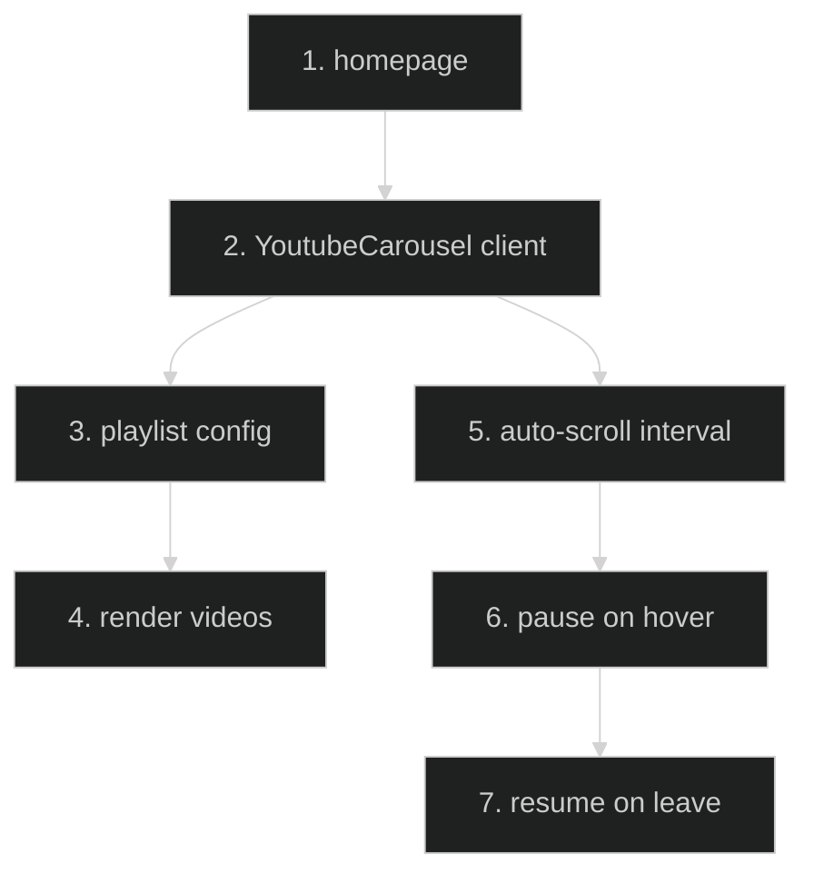

# YouTube Playlist Integration — Feature Flow

Documentation for **YouTube playlist integration** (Phase 4.1): auto-scrolling carousel on homepage.

## Diagram

## Key files

- `app/_components/YoutubeCarousel.tsx`
- `app/_components/YoutubeCarouselSkeleton.tsx`
- `app/page.tsx`

## Step-by-step actions

1. Homepage renders `YoutubeCarousel` (client component).
2. Playlist config (video IDs / playlist ID) provided in component (or config).
3. Renders video thumbnails in horizontal scroll container.
4. Auto-scrolls on interval (setInterval).
5. Pauses on hover (clearInterval).
6. Resumes on mouse leave.
7. Skeleton shown during loading (`YoutubeCarouselSkeleton`).

## Data flow

- Client-side only; no API calls; videos from YouTube CDN.

## Assumptions

- Playlist ID hardcoded in component (verify).

---

**Status**: Feature 18 of N.
