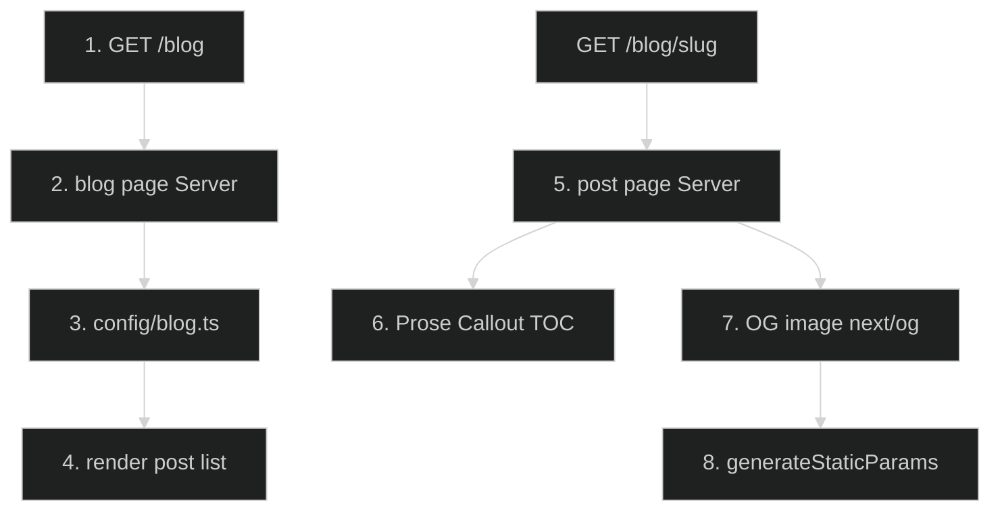

# Engineering Blog — Feature Flow

Documentation for **Engineering blog** (Phase 4.2): public `/blog` with 5 deep technical posts.

## Diagram

## Key files

- `app/blog/page.tsx`, `app/blog/layout.tsx`
- `app/blog/[slug]/page.tsx` (5 posts: designing-scalable-architecture, caching-strategies-nextjs-app-router, server-client-boundary, rate-limiting-on-serverless, sandboxed-code-execution)
- `app/blog/[slug]/opengraph-image.tsx`
- `config/blog.ts`
- `components/blog/` (Prose, Callout, TableOfContents)
- `lib/blog-seo.ts`
- `scripts/check-blog-toc.ts`

## Step-by-step actions

1. Browser requests `/blog` (public route).
2. Server page reads post registry from `config/blog.ts` (title, date, description, tags, TOC).
3. Renders post list with metadata.
4. Browser requests `/blog/{slug}`.
5. Server renders post (static Server Component, no markdown pipeline).
6. Reading primitives: Prose (70ch measure), Callout (note/tip/warning/trap), TableOfContents (sticky rail + mobile disclosure, one IntersectionObserver).
7. OG image generated via `next/og` with `generateStaticParams` (build-time, not per-request).
8. `npm run check:blog-toc` validates TOC anchors and post registration (both directions) post-Build.

## Data flow

- Static Server Components (no DB, no markdown); single source of truth `config/blog.ts`.
- SEO via `lib/blog-seo.ts` (canonical, og:type=article, JSON-LD).

## Conditional branches

- `[Unknown slug]` → 404 (no ISR cache file written — I.10 fixed).

## Assumptions

- Legacy markdown pipeline removed (I.10); only static routes remain.

---

**Status**: Feature 19 of N.
