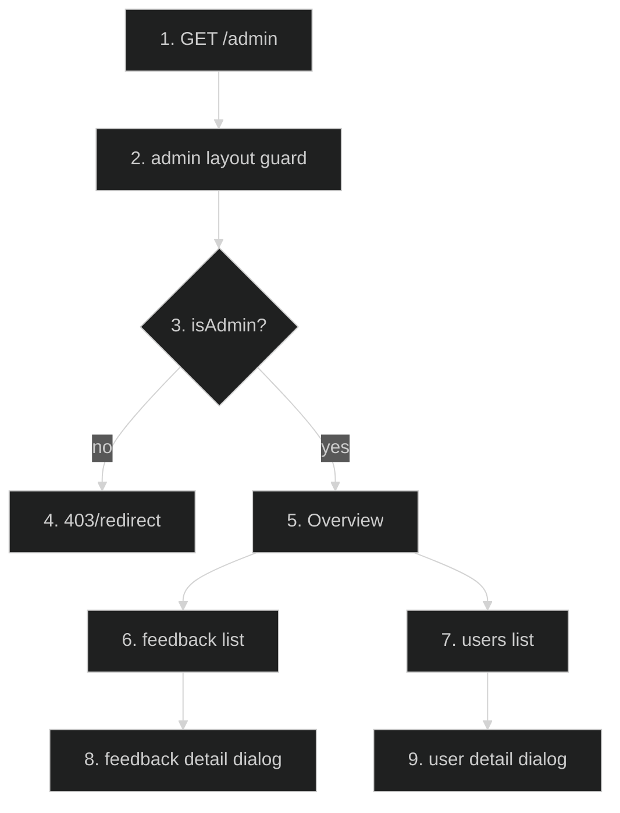

# Admin Tools — Feature Flow

Documentation for **Admin tools** (Phase 4.6): control panel at `/admin` (Overview, Feedback, Users).

## Diagram

## Key files

- `app/admin/layout.tsx`, `app/admin/page.tsx`
- `app/admin/_components/AdminShell.tsx`, `AdminSidebar.tsx`, `AdminHeader.tsx`, `OverviewStats.tsx`, `QuickActions.tsx`
- `app/admin/feedback/page.tsx`, `app/admin/feedback/_components/FeedbackTable.tsx`, `FeedbackDetailDialog.tsx`
- `app/admin/users/page.tsx`, `app/admin/users/_components/UsersTable.tsx`, `UserDetailDialog.tsx`
- `app/api/admin/overview/route.ts`, `app/api/admin/feedback/route.ts`, `app/api/admin/feedback/[id]/route.ts`, `app/api/admin/users/route.ts`, `app/api/admin/users/[id]/route.ts`
- `lib/admin-auth.ts`

## Step-by-step actions

1. Browser requests `/admin/*` (authenticated route group; proxy.ts requires session).
2. Admin layout guard checks `isAdmin()` (email/clerkId in `ADMIN_EMAILS`/`ADMIN_CLERK_IDS` env allowlist); else 403/redirect.
3. Overview page shows stats (users, feedback counts) via `/api/admin/overview`.
4. Feedback page lists tickets via `/api/admin/feedback` (rate-limited 10/min); detail dialog shows full ticket.
5. Users page lists users via `/api/admin/users`; detail dialog shows user info.
6. All admin API routes: Zod validation + `auth()` + `isAdmin()` + rate limit (10/min each scope).
7. Fail-closed: if env allowlist empty, no one is admin.

## Data flow

- Env allowlist auth (no DB role table); handler-level checks are defense-in-depth (proxy already 307s unsigned).

## Conditional branches

- `[Not admin]` → 403.
- `[Unauthenticated]` → 307 to /sign-in (proxy).

## Assumptions

- Admin link not in main sidebar (Known Debt); reachable by typing URL.

---

**Status**: Feature 20 of N.
