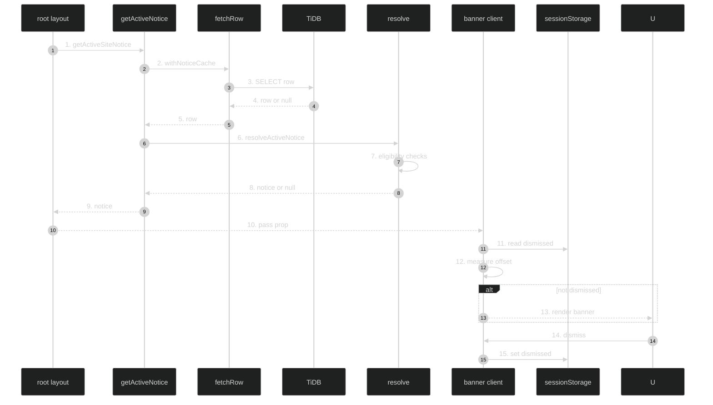

# Site Notice Banner — Feature Flow

Documentation for **Site notice banner** (Phase 4.7, In Progress): admin-toggled global notice.

## Diagram

## Key files

- `lib/site-notice.ts`
- `components/SiteNoticeBanner.tsx`
- `app/admin/site-notice/page.tsx`
- `app/admin/site-notice/_components/SiteNoticeForm.tsx`
- `app/api/admin/site-notice/route.ts`
- `config/site-notice.ts`
- `config/schema.tsx` (site_notices)

## Step-by-step actions

1. Root layout (Server) calls `getActiveSiteNotice()` (React `cache()` dedupes per request).
2. `withNoticeCache("active", readActiveNotice)` wraps in `unstable_cache` (tag "site-notice", ttl 3600s).
3. `fetchRow` runs `SELECT ... FROM site_notices WHERE id=1` with `withConnectRetry`.
4. TiDB returns row or null.
5. Row passed back.
6. `resolveActiveNotice(row, now)` evaluates eligibility.
7. Checks: env `SITE_NOTICE_DISABLED=true` → null; no row → null; `!is_enabled` → null; `expires_at <= now` → null; else projects 5 primitive fields (no `updated_by`).
8. Returns `ActiveSiteNotice | null`.
9. Notice returned to root layout (primitives only).
10. Passed as prop to `SiteNoticeBanner` (client).
11. Client `useEffect` reads `sessionStorage` key `site-notice-dismissed:{version}`; null until hydrated.
12. `useTopChromeOffset` measures `max(getBoundingClientRect().bottom)` over header/toggle, skipping zero-height.
13. If notice present and not dismissed: renders banner (severity color) or modal at computed top offset (z-40).
14. User clicks dismiss.
15. Client sets sessionStorage dismissed flag for this version and hides.
16. Admin PATCH `/api/admin/site-notice`: Zod validate → auth + isAdmin → rate limit 10/min → `updateSiteNotice` (upsert) → `revalidateTag("site-notice", {expire:0})`.

## Data flow

- Cached read in root layout (1h TTL becomes ISR window); admin write invalidates via revalidateTag.
- Public projection allowlists 5 primitive fields (no `updated_by` leak).

## Conditional branches

- `[Env disabled]` → null.
- `[Disabled/expired]` → null.
- `[Dismissed]` → hidden.

## Assumptions

- Tasks 7-9 pending (per tracker); diagram covers Tasks 1-6.

---

**Status**: Feature 21 of N.
