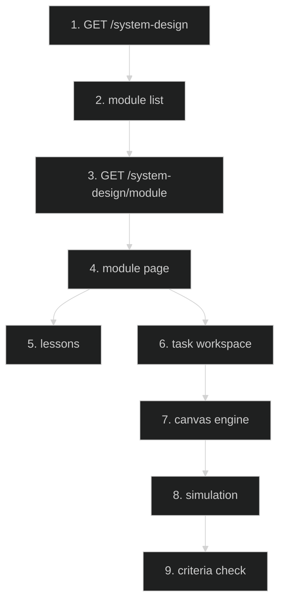

# System Design Learning — Feature Flow

Documentation for **System design learning path** (Phase 6.1, In Progress): engine, canvas, routes, task workspace.

## Diagram

## Key files

- `app/(routes)/system-design/page.tsx`
- `app/(routes)/system-design/[module]/page.tsx`
- `app/(routes)/system-design/[module]/lesson/[lesson]/page.tsx`
- `app/(routes)/system-design/[module]/task/page.tsx`
- `config/system-design/registry.ts`
- `lib/system-design/` (engine, geometry, rubric, content-rules)
- `components/` (canvas, ModuleLayout)

## Step-by-step actions

1. Browser requests `/system-design` → module list page.
2. Server renders modules from `config/system-design/registry.ts`.
3. Browser requests `/system-design/{module}` → module page (overview + lessons + task).
4. Module page renders `ModuleLayout` with `module.chapters` (leaf model: 1 leaf = 1 lesson).
5. Lesson route renders lesson content (markdown/prose).
6. Task route renders task workspace with canvas.
7. Canvas engine (`lib/system-design`) renders node graph; user edits nodes/edges.
8. Simulation runs (`rubric.ts` checks criteria: zero-errors, headroom, etc.).
9. Criteria pass/fail shown; progress saved to `sd_user_state`.

## Data flow

- Schema: `sd_user_state` (1 row per user, completed keys).
- Content rules enforced by `lib/system-design/content-rules.ts` (npm test + check:system-design).
- Guardrail script `npm run check:system-design` validates registry both directions.

## Conditional branches

- `[Lesson not found]` → 404.
- `[Task criteria fail]` → show progress, allow retry.

## Assumptions

- Engine cannot measure storage dimension (sharding shortcut documented in module 9).
- 14 modules total (A3 complete); Content 2.0 in progress (B slices).

---

**Status**: Feature 22 of N.
