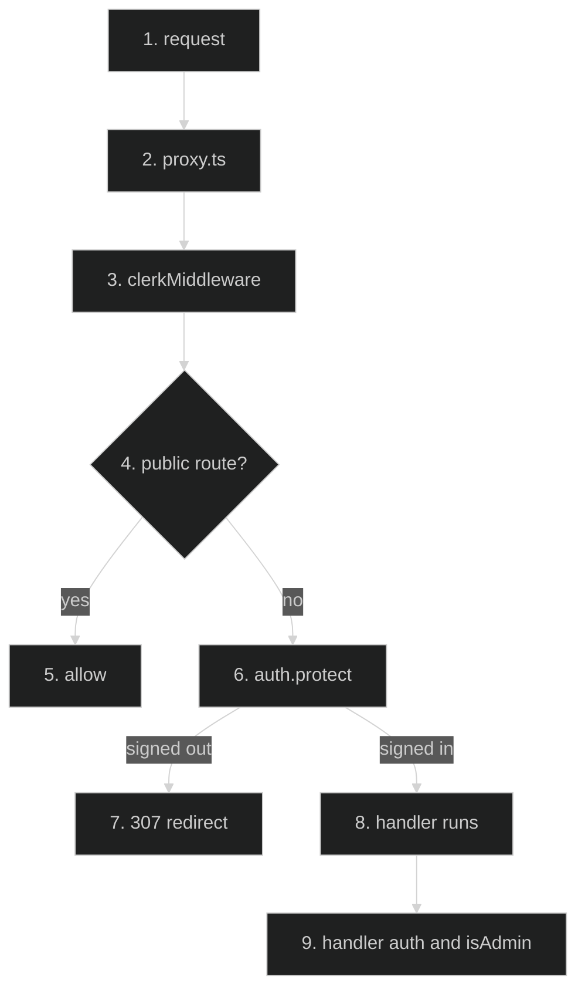

# Auth Boundary (Clerk Middleware) — Feature Flow

Documentation for the **Auth boundary** cross-cutting feature (Infrastructure). Dark-themed Mermaid + step-by-step actions.

## Diagram

## Key files

- `proxy.ts`
- `lib/admin-auth.ts`
- `app/admin/layout.tsx`

## Step-by-step actions

1. Any HTTP request hits `proxy.ts` (matcher excludes static assets).
2. `clerkMiddleware` wraps handler; `auth()` resolves session to `userId`.
3. If pathname starts with `/sign-up`, redirect to `/sign-in`.
4. Check `isPublicRoute(pathname)`: public list = `/`, `/whats-new`, `/blog/*`, `/sign-in/*`, `/robots.txt`, `/sitemap.xml`, `/api/health/*`, `/api/cron/*`.
5. If public: allow through without `auth.protect()`.
6. If not public: call `auth.protect()`; signed-out users get 307 redirect to `/sign-in`.
7. Signed-in requests proceed to route handler or page.
8. Handler calls `auth()` again (defense-in-depth) and `isAdmin()` for admin routes.
9. Admin check compares email/clerkId against `ADMIN_EMAILS`/`ADMIN_CLERK_IDS` env allowlist; else 403.

## Data flow

- Public list includes `/`, `/blog`, `/sign-in`, `/api/cron`, etc.; everything else requires session; handler-level `auth()`/`isAdmin()` are defense-in-depth (unreachable unsigned due to 307).

## Conditional branches

- `[Public route]` → allow.
- `[Signed out on protected route]` → 307.
- `[Admin route, not admin]` → 403.

## Assumptions

- `ADMIN_EMAILS`/`ADMIN_CLERK_IDS` env must be set; empty = no admins (fail-closed).

---

**Status**: Feature 23 of N.
