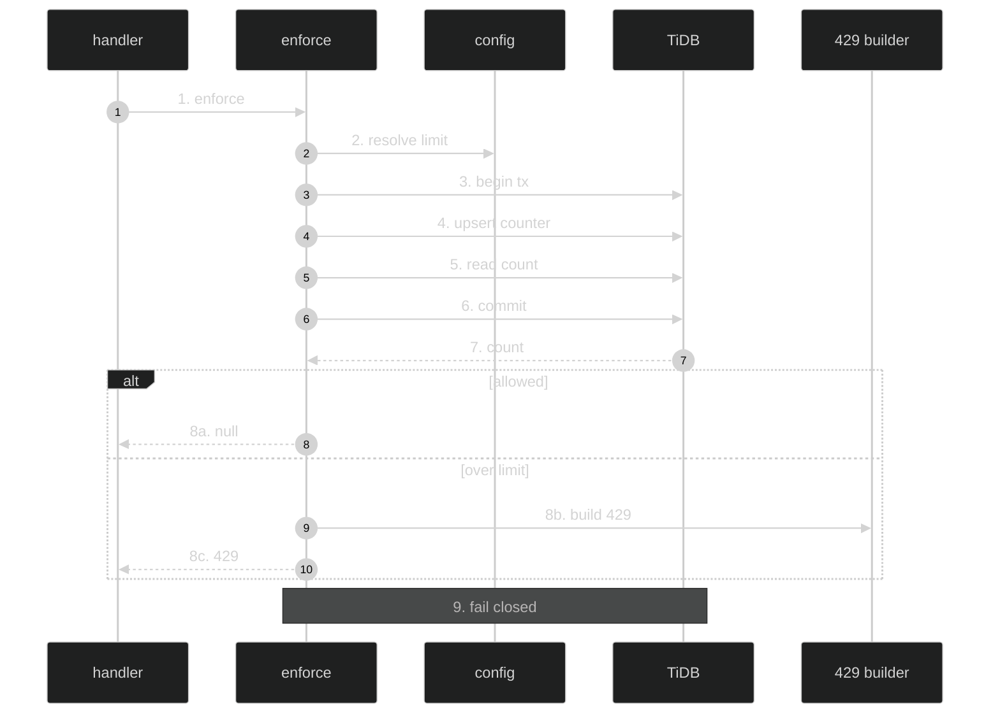

# DB-Backed Rate Limiting — Feature Flow

Documentation for the **DB-backed rate limiting** cross-cutting feature (Infrastructure). Dark-themed Mermaid + step-by-step actions.

## Diagram

## Key files

- `lib/db-rate-limit.ts`
- `config/rate-limits.ts`
- `config/schema.tsx` (rate_limits table)
- `lib/api-error.ts`

## Step-by-step actions

1. Handler calls `enforceDbRateLimit(userId, scope, pathname, method)`.
2. `getRateLimitConfig(pathname, method)` resolves `{ limit, windowMs }` from `config/rate-limits.ts` (enroll:5/60s, progress:10/60s, mentor-chat:5/60s, generate:10/60s, admin-*:10/60s, default:20/60s).
3. `consumeDbRateLimit` computes `bucket = "user:{userId}:{scope}"` and `windowStart = floor(now/windowMs)*windowMs`.
4. Begins transaction on a pinned connection.
5. Executes `INSERT INTO rate_limits (bucket, window_start, count) VALUES (...) ON DUPLICATE KEY UPDATE count = LAST_INSERT_ID(IF(window_start >= windowStart, count+1, 1)), window_start = IF(...)` (atomic counter).
6. `SELECT LAST_INSERT_ID() AS c` (reads this caller's own position; no stale read).
7. Commits transaction.
8. Returns count (caller's position in window).
9a. If `count <= limit`: returns null (allowed); remaining = limit - count.
9b. If over limit: builds 429 response with `Retry-After` header and JSON body.
9c. Returns 429 response.
10. Fail-closed: if TiDB unreachable, throws -> handler returns 500 (never silently allows).

## Data flow

- Fixed window per (user, scope) in a shared TiDB table; atomic upsert via `LAST_INSERT_ID`; global across serverless instances; fail-closed.

## Conditional branches

- `[count <= limit]` → allowed (null).
- `[count > limit]` → 429 with retry-after.
- `[TiDB unreachable]` → 500 (fail-closed).

## Assumptions

- `rate_limits` table has unique index on `bucket` (verify in schema).

---

**Status**: Feature 24 of N.
