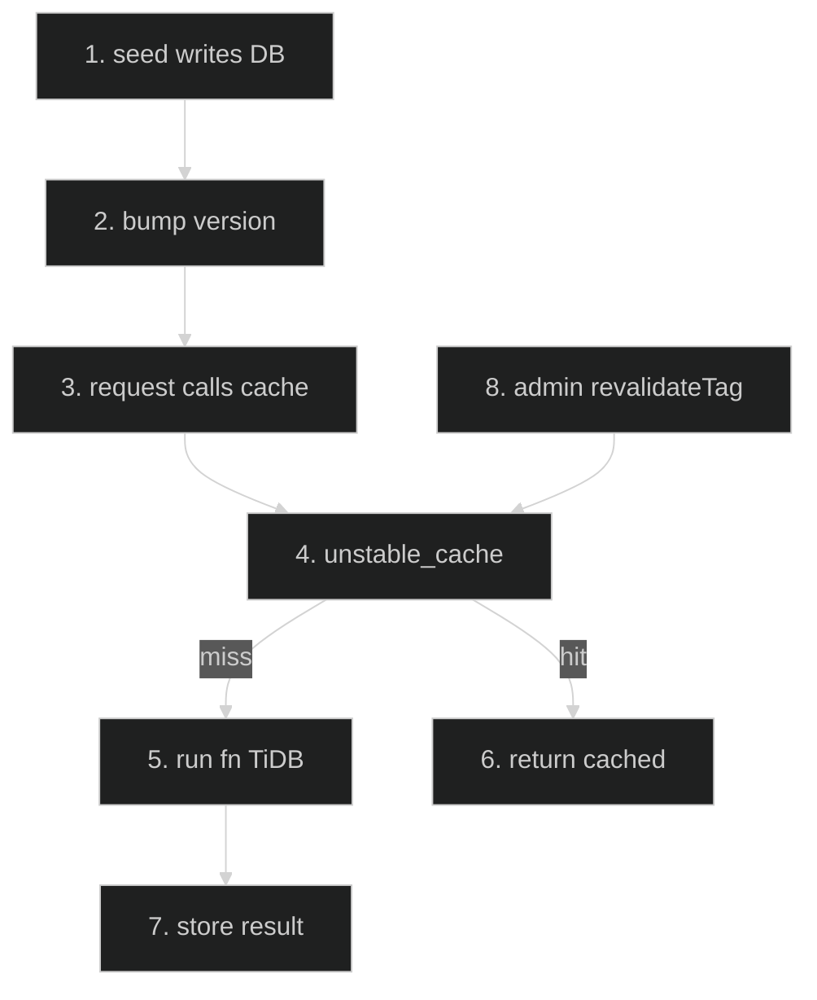

# Content Cache (unstable_cache wrapper) — Feature Flow

Documentation for the **Content cache** cross-cutting feature (Infrastructure). Dark-themed Mermaid + step-by-step actions.

## Diagram

## Key files

- `lib/content-cache.ts`
- `lib/site-notice.ts` (consumer: tag "site-notice", ttl 3600s)
- `config/site-notice.ts`

## Step-by-step actions

1. Seed script runs outside Next.js runtime and writes rows to TiDB.
2. Developer bumps `version` in `createContentCache` config (invalidates old cache entries).
3. Request arrives; Server Component calls `withContentCache(key, fn)`.
4. `unstable_cache` wraps `fn` with cache key `[key, version]`, tag, and `revalidate=ttl`.
5. On cache miss: executes `fn` -> Drizzle SELECT -> TiDB.
6. On cache hit: returns cached value (shared reference; treat as read-only).
7. Stores result in cache for `ttl` seconds.
8. (Future) admin endpoint can call `revalidateTag(tag)` for early invalidation.

## Data flow

- Version-bump invalidation for seed scripts (no revalidateTag at seed time); tag reserved for admin endpoint; cached values are shared references (read-only).

## Conditional branches

- `[Cache hit]` → return cached.
- `[Cache miss]` → query TiDB, store.

## Assumptions

- Cached values must be treated as read-only (shared references).

---

**Status**: Feature 25 of N.
