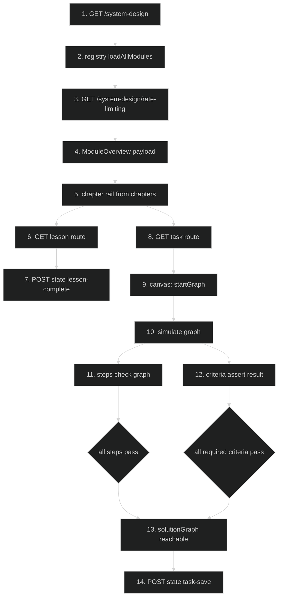
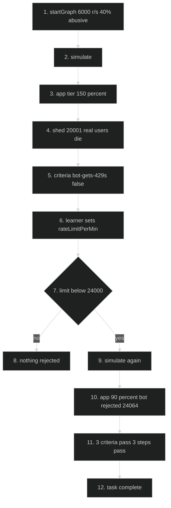
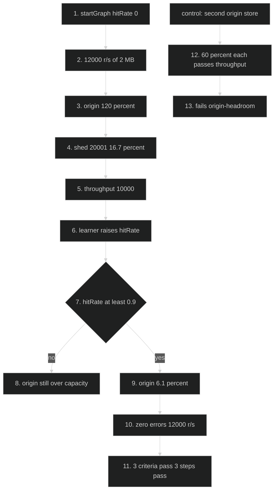

# Rate Limiting + CDN Modules — Feature Flow

Documentation for **Phase B6 of the system-design content rebuild** (plan 17 §7.6): module 10
`rate-limiting` and module 11 `cdns-and-static-content`, both converted to the leaf model
(1 chapter leaf = 1 lesson), both with re-measured tasks.

This feature is content, not code — the engine, routes and persistence are unchanged. What the diagrams
show is the path a learner takes, and the two simulations that decide whether the task they were given
grades the decision or only its consequence.

## Diagram 1 — Learner path through a converted module

## Diagram 2 — Module 10 task: the start is failing, the limit is the fix

## Diagram 3 — Module 11 task: the origin is the bottleneck, the hit rate is the fix

## Key files

- `config/system-design/modules/rate-limiting.ts` — module 10: 6 lessons, 3 chapter groups, `taskGraph(limitPerMin)`, 3 steps, 3 criteria
- `config/system-design/modules/cdns-and-static-content.ts` — module 11: 6 lessons, 3 chapter groups, `graph(hitRate)`, 3 steps, 3 criteria
- `config/system-design/registry.ts` — `loadAllModules()`, `getModule()`; the source both the pages and the gates read
- `lib/system-design/content-rules.ts` — `inspectChapterBinding`, `collectChapterLeaves`, `lessonNav`, `countLessonWords`
- `lib/system-design/engine.ts` — `simulate(graph, failures, seed)`; `effectiveCapacity`, the cache-hit short circuit, `bandwidthMbps`
- `lib/system-design/nodes.ts` — `NODE_TYPES` capacities (app 2,000 r/s per replica, object store 10,000, balancer 20,000) and `defaultNode`
- `app/(routes)/system-design/[module]/page.tsx` — module overview (titles + counts, not `SdModule`)
- `app/(routes)/system-design/[module]/lesson/[lesson]/page.tsx` — one lesson
- `app/(routes)/system-design/[module]/task/page.tsx` — canvas + steps + criteria
- `app/api/system-design/state/route.ts` — `lesson-complete` / `task-save` persistence
- `tests/system-design-content.test.ts` — the B6 suites (modules 10 and 11, 16 assertions)
- `scripts/check-system-design.ts` — post-build gate: binding, steps on solution, criteria sanity, chain

## Step-by-step actions

### Phase 1 — Request and content resolution

1. Browser requests `/system-design`; the Server Component calls `loadAllModules()` and renders the
   15-module list from `config/system-design/registry.ts`. No DB read.
2. Browser requests `/system-design/rate-limiting`; `getModule("rate-limiting")` resolves through the
   registry's `LOADERS` map (prototype-safe lookup) and the page passes an **overview** type — titles,
   counts, `interviewByte` — not the `SdModule` object. This is a payload decision: handing the whole
   module to a client component shipped every lesson body and both task graphs once already (module 1
   was 65,625 bytes for 4 lessons before the boundary was narrowed).
3. `ModuleLayout` renders `module.chapters` as the rail. It is `lessonNav(module)` under the hood, which
   returns chapter-leaf order **only when** `inspectChapterBinding` reports `bound`; otherwise it falls
   back to lesson order. Both modules are bound (6 leaves / 6 lessons), so the rail _is_ the outline.
4. Lesson route: `GET /system-design/rate-limiting/lesson/the-bot-in-your-traffic`. The page resolves the
   lesson by slug from the module and renders its sections; `sources` render as "Go deeper" links.
5. `POST /api/system-design/state` with `{ kind: "lesson-complete", slug: "<module>/<lesson>" }`.
   Zod validates the slug (1–120 chars), Clerk `auth()` authenticates, `user-sync`-style lookup maps the
   Clerk id to `users.id`, the DB rate limiter applies, and one row is upserted in `sd_user_state`
   (`completed_keys` JSON). Response 200; failure paths 400/401/429/500 via `lib/api-error.ts`.

### Phase 2 — Task simulation (module 10)

6. `GET /system-design/rate-limiting/task` mounts the workspace with `task.startGraph`:
   `client-1 → lb-1 → app-1 → db-1`, `arrivalRate 6000`, `writeShare 0.9`, `abusiveShare 0.4`,
   `app-1.replicas 2` (4,000 r/s), `db-1` at 5,000 r/s, `lb-1.rateLimitPerMin null`.
7. `simulate(graph)` runs a **10-second** window in 1,000 steps of 10 ms
   (`SIMULATION_WINDOW_SECONDS / TIME_STEP_SECONDS`), routing each arrival through
   `pathsToTerminals`. Measured: app tier
   **150%**, store 80%, balancer 30% — the app instance sheds **all** arrivals that reach it, which is
   20,001 requests (33.3%), throughput 4,000 r/s, p95 14.2 ms.
8. Criteria (`assert(result)`, which sees only a `SimulationResult`): `bot-gets-429s` false
   (`rejected 0`), `real-users-complete` false (`shed 20,001`), `app-headroom` false (150% ≥ 95%).
9. Steps (`check(graph)`, which sees the graph): `set-rate-limit` false (no limit), `keep-the-load` true
   (6,000 r/s), `leave-room-for-real-clients` false (no limit).
10. Learner selects `lb-1` and sets `rateLimitPerMin = 3600`. The engine's comparison is
    `arrivalRate × abusiveShare > limitPerSec` — 2,400 r/s > 60 r/s — so **every** abusive arrival is
    rejected, at the door, before it consumes app capacity.
11. Re-simulate: `rejected 24,064`, `shed 0`, app tier **90%**, store 72%, throughput 3,594 r/s,
    p95 10.9 ms. All three criteria pass; all three steps pass.
12. `POST /api/system-design/state` with `{ kind: "task-save", taskSlug, graph, steps, criteriaMet }`.
    `SdGraphSchema` validates the shape, `validateGraph` re-checks topology server-side (unreachable
    terminal, dangling edge) before the row is written, and `users.clerk_id` maps the Clerk id to
    `users.id`, so a crafted graph cannot be persisted as "solved".

### Phase 3 — Task simulation (module 11)

13. `GET /system-design/cdns-and-static-content/task` mounts `graph(0)`:
    `client-1 → lb-1 → app-1 → cdn-1 → origin-1`, `arrivalRate 12000`, `mediaShare 1`,
    `bytesPerMediaRequest 2_000_000`, `app-1.replicas 8`, `cdn-1.hitRate 0`, `origin-1` a 10,000 r/s
    object store.
14. `simulate` → origin **120%**, **20,001 segments shed** (16.7%), throughput 10,000 r/s, p95 5.24 ms.
    The app tier is healthy at 75% and the balancer at 60%, which is the lesson: the dashboard that
    counts requests is green, the tier that pays for bytes is on fire.
15. Criteria: `origin-headroom` false (120%), `zero-errors` false, `capacity-served` false
    (10,000 < 11,500). Steps: `keep-the-media-path` true, `keep-the-load` true,
    `raise-the-hit-rate` false.
16. Learner sets `cdn-1.hitRate = 0.95`. The cache short-circuit applies only when `hop < path.length - 1`,
    so a hit is answered _at_ the CDN and a miss continues to the origin. Origin arrival rate becomes
    600 r/s: **6.1%** utilisation, zero errors, 12,000 r/s served, p95 3.20 ms.
17. All criteria and steps pass → `task-save` persists, same validation path as step 12.

### Phase 4 — Gates

18. `npm test` (before Build, DB-free) runs `tests/system-design-content.test.ts`: binding both
    directions, depth 700–900 words, outline order vs lesson order, start fails every required criterion,
    solution passes every one, the control graphs (a 1 req/min allowance passes all criteria but fails
    its step; a second origin store passes throughput and errors but fails `origin-headroom`), the
    anchors (`concurrency-limits`, `Open Connect`), the D1 banned-word list, and the two pinned model
    limitations (at 1,000 r/s every criterion passes; `bandwidthMbps` is 192,000 at both a 50% and a 95%
    hit rate). 634 tests.
19. `npm run build` → 151 static pages; module pages 63,531 (`rate-limiting`) and 65,072
    (`cdns-and-static-content`) bytes.
20. `npm run check:system-design` (after Build; reads the prerender manifest) → all checks passed for 15
    modules, **8 warnings**: 4 unconverted outlines (B7) and 4 chain warnings, each answered in the
    module header that raises it.

## Data flow

- **Content → page**: `config/system-design/modules/*.ts` is read at build time by the registry; both
  modules are fully prerendered, so a lesson costs no DB query and no function invocation.
- **Content → gate**: the same objects feed `npm test` (data invariants, seconds, no DB) and
  `check:system-design` (prerender + step/criteria sanity, post-build). Neither reads the other's cache.
- **Learner → DB**: only `sd_user_state` is written — one row per user, `completed_keys` and a task JSON
  column — via a single validated upsert through `app/api/system-design/state/route.ts`.
- **Engine → UI**: `simulate()` returns `throughput`, `latency`, `errorRate`, `errorClasses`,
  `bandwidthMbps`, `perNode` and `teaching`. Criteria read the result; steps read the graph. That split
  is the design: the graph is what the learner decided, the result is what it caused.
- **No bytes dimension**: `effectiveCapacity` is requests/second, and `bandwidthMbps` counts delivered
  bytes per completed request — so the CDN's benefit is visible as the origin's arrival rate and nowhere
  else. Lesson 5 states this; a test asserts it, so an engine change fails the suite.

## Conditional branches

- `[Bound outline]` → rail renders chapter-leaf order; `[unbound]` → falls back to lesson order and
  `check:system-design` warns.
- `[rateLimitPerMin null or ≥ 24,000]` → nothing is rejected; `bot-gets-429s` false.
- `[rateLimitPerMin 1–599]` → criteria pass (the engine cannot model a real client's rate), the
  `leave-room-for-real-clients` step fails.
- `[arrivalRate < 6,000]` → `keep-the-load` fails, every criterion passes.
- `[hitRate ≥ 0.9]` → origin headroom reached; `[< 0.9]` → origin still over capacity.
- `[second origin store]` → throughput and errors pass, `origin-headroom` fails.
- `[unauthenticated state write]` → `proxy.ts` redirects (307) before the handler; handler-level `auth()`
  is defense in depth.
- `[rate limit exceeded]` → 429 from `enforceDbRateLimit`, fail-closed.

## Assumptions

- Module 10's limiter is a threshold on the **aggregate** abusive arrival rate, not a per-client bucket,
  so it has exactly two outcomes. The step band (600–23,999 req/min) encodes the judgement the engine
  cannot measure; that is stated in the plan and pinned by a test rather than implied.
- Module 11's `bandwidthMbps` reading of 192,000 Mbit/s at both 50% and 95% hit rates is measured on
  this build, not inferred; the 24 GB/s figure in lesson 1 is arithmetic, not a simulation output.
- Route and state shapes were read from `app/api/system-design/state/route.ts`, not assumed.

---

**Status**: Feature 26 of N.
