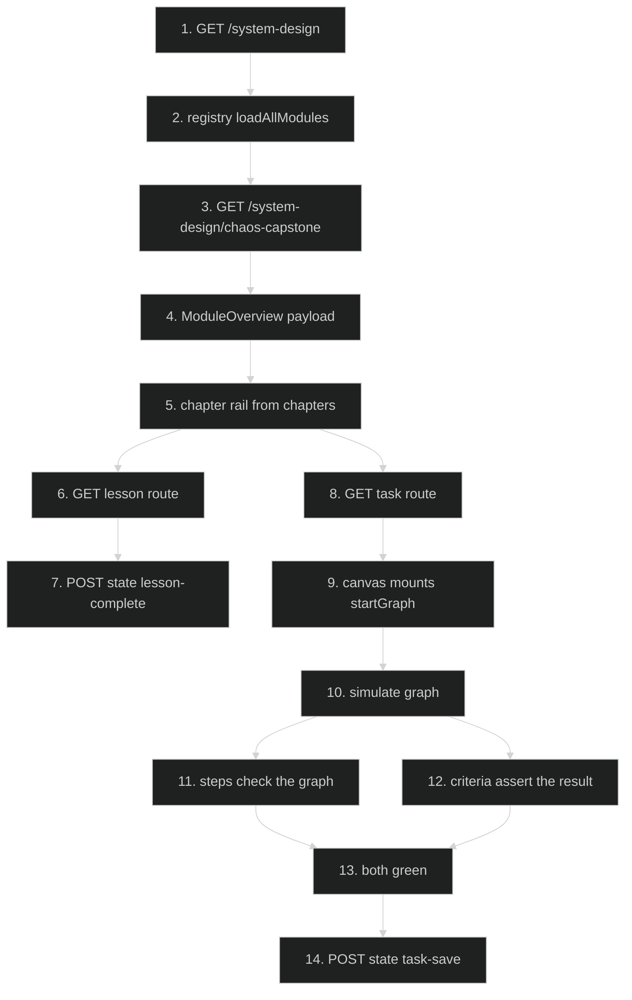
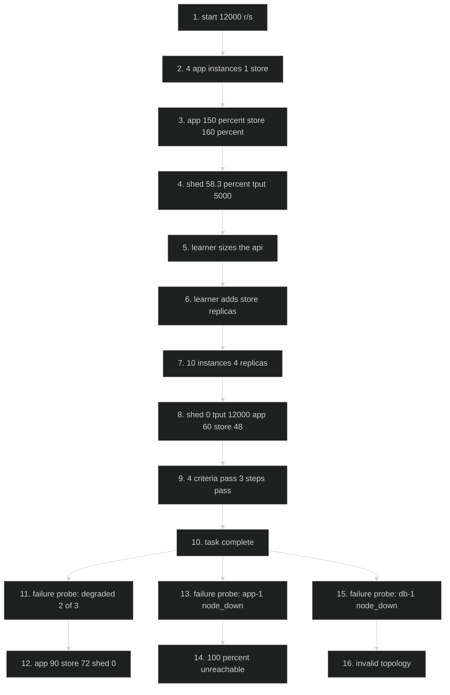
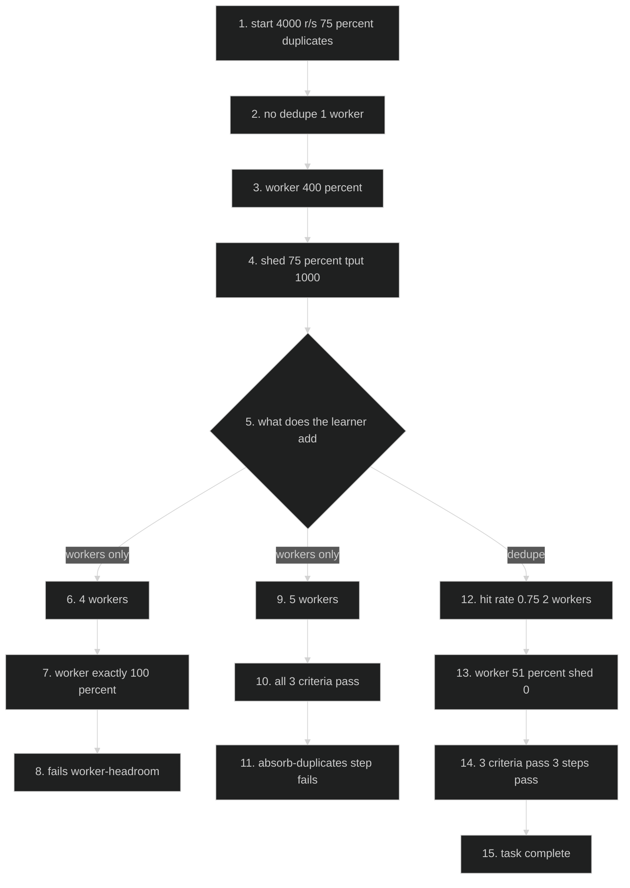
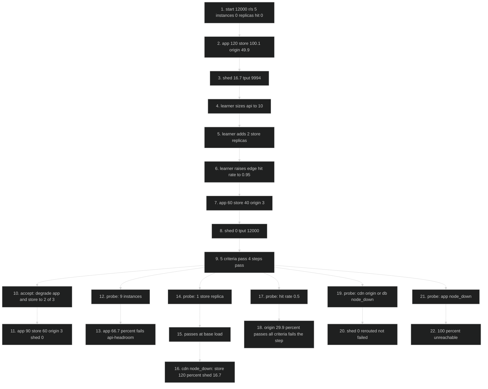

# Reliability Modules (M12–M15) — Feature Flow

Documentation for **Phase B7 of the system-design content rebuild** (plan 17 §7.7): module 12
`how-systems-fail`, module 13 `timeouts-retries-circuit-breakers`, module 14 `idempotency` and
module 15 `chaos-capstone`. These are the last four outlines, so this slice also closes the leaf model:
1 chapter leaf = 1 lesson, every leaf bound, `SdChapter.lessonSlug` required by the type.

This is content, not code. The engine, routes, persistence and gates are unchanged. What the diagrams
show is the path a learner takes, and the three simulations where the _task_ had to be rebuilt — because
three of the four original tasks graded fields that `simulate()` never reads.

The standing pattern this slice established:

| Layer                         | Grades                                                  | Sees                 |
| ----------------------------- | ------------------------------------------------------- | -------------------- |
| **Criteria** (`passCriteria`) | a consequence the engine models                         | a `SimulationResult` |
| **Steps** (`steps`)           | a decision the engine cannot see                        | the `SdGraph`        |
| **Lesson**                    | states the model's limitation in the module's own voice | —                    |
| **Test**                      | asserts the limitation still holds                      | both                 |

## Diagram 1 — Learner path through a converted reliability module

## Diagram 2 — Module 12: the start is over capacity, and replicas are not redundancy

Steps 11–16 are not the learner's task; they are the acceptance test and the lesson's disclosure. The
task's own claim is step 12 — degradation survives — and steps 14–16 are what the canvas cannot call
survival, because `node_down` removes the node **and every replica of it**.

## Diagram 3 — Module 14: duplicates, the arithmetic, and the cheat the criteria cannot see

Five workers with no idempotency store absorb nothing and pass every criterion, because the criteria
count what the engine can see and the engine cannot see a duplicate. That is why `absorb-duplicates`
(hit rate ≥ 0.7) is a **step**, and the suite asserts the cheat still passes the criteria _and_ still
fails the step.

## Diagram 4 — Module 15: the capstone sizes the design, then removes a third of it

Steps 12–22 are the argument for keeping steps and criteria separate: the criteria grade the load the
design must survive, the steps grade the decisions that make the _next_ failure survivable. Steps 19–22
are the model's two honest limits — a second terminal reroutes instead of failing, and a lost app tier
has no alternative path.

## Key files

- `config/system-design/modules/how-systems-fail.ts` — module 12: 5 lessons, 3 chapter groups, `topGraph(arrivalRate, appReplicas, readReplicas)`, 3 steps, 4 criteria
- `config/system-design/modules/timeouts-retries-circuit-breakers.ts` — module 13: 5 lessons, 3 groups, `imageGraph(arrivalRate, resizePath, readReplicas)`, 3 steps, 3 criteria (1 advisory)
- `config/system-design/modules/idempotency.ts` — module 14: 4 lessons, 3 groups, `uploadGraph(rate, duplicateShare, workerReplicas, dlqEnabled)`, 3 steps, 3 criteria
- `config/system-design/modules/chaos-capstone.ts` — module 15: 3 lessons, 3 groups, `playbackGraph(appReplicas, readReplicas, cdnHitRate)`, 4 steps, 5 criteria
- `config/system-design/types.ts` — `SdChapter` union (`{ lessonSlug: string } | { children: SdChapter[] }`), `SdFailure`, `SdPassCriterion`, `SdStep`
- `config/system-design/registry.ts` — `loadAllModules()`, `getModule()`; the source both the pages and the gates read
- `lib/system-design/content-rules.ts` — `inspectChapterBinding`, `collectChapterLeaves`, `lessonNav`, `countLessonWords`
- `lib/system-design/engine.ts` — `simulate(graph, failures, seed)`; `effectiveCapacity`, `precompute`, `pathsToTerminals`
- `lib/system-design/nodes.ts` — `NODE_TYPES` capacities (app 2,000 r/s per replica, store 5,000, object store 10,000, balancer 20,000)
- `app/(routes)/system-design/[module]/page.tsx` — module overview (titles + counts, not `SdModule`)
- `app/(routes)/system-design/[module]/lesson/[lesson]/page.tsx` — one lesson, `sources` render as "Go deeper"
- `app/(routes)/system-design/[module]/task/page.tsx` — canvas + steps + criteria
- `app/api/system-design/state/route.ts` — `lesson-complete` / `task-save` persistence
- `tests/system-design-content.test.ts` — the B7 suites (23 assertions) plus the cross-module "every task has a reachable finish" invariant
- `scripts/check-system-design.ts` — post-build gate: binding, steps on the solution, criteria sanity, chain

## Step-by-step actions

### Phase 1 — Request and content resolution

1. Browser requests `/system-design`; the Server Component calls `loadAllModules()` and renders the
   15-module list from `config/system-design/registry.ts`. No DB read.
2. Browser requests `/system-design/how-systems-fail`; `getModule("how-systems-fail")` resolves through
   the registry's prototype-safe `LOADERS` lookup, and the page passes an **overview** type — titles,
   counts, `interviewByte` — not the whole `SdModule`. This is the payload boundary B1 introduced after
   measuring a 65,625-byte module page that shipped every lesson body and both task graphs.
3. `ModuleLayout` renders `module.chapters` as the rail (`lessonNav(module)`), which returns chapter-leaf
   order **only when** `inspectChapterBinding` reports `bound`. All four modules are bound (5/5/4/3
   leaves against 5/5/4/3 lessons), so the rail _is_ the outline.
4. Lesson route: `GET /system-design/idempotency/lesson/exactly-once-is-a-lie`. The page resolves the
   lesson by slug and renders its sections; `sources` render as "Go deeper" links, and the model
   limitation is stated in the lesson body — module 13 lesson 3 for `breakerEnabled`, module 14
   lesson 4 for the queue's retry fields, module 12 lesson 4 and module 15 lesson 2 for `replicas`.
5. `POST /api/system-design/state` with `{ kind: "lesson-complete", slug: "<module>/<lesson>" }`.
   Zod validates the slug (1–120 chars), Clerk `auth()` authenticates, the Clerk id maps to `users.id`,
   the DB rate limiter applies, and one validated upsert writes `sd_user_state.completed_keys`.
   Response 200; failures surface as 400/401/429/500 through `lib/api-error.ts`.

### Phase 2 — Module 12 task (12,000 r/s)

6. `GET /system-design/how-systems-fail/task` mounts `task.startGraph`:
   `client-1 → lb-1 → app-1 → db-1`, `arrivalRate 12000`, `app-1.replicas 4` (8,000 r/s),
   `db-1.readReplicas 0` (5,000 r/s).
7. `simulate(graph)` runs a **10-second** window in 1,000 steps of 10 ms. Measured: app **150%**,
   store **160%**, balancer 60%, **58.3% shed**, throughput **5,000 r/s**, p95 9.9 ms. The store is the
   worse bottleneck, which is the point: sizing only the tier named in the lesson's title is not enough.
8. Criteria (`assert(result)`): `zero-errors` false, `capacity-served` false (5,000 < 11,900),
   `api-headroom` false (150% ≥ 65%), `store-headroom` false (160% ≥ 65%).
9. Steps (`check(graph)`): `size-the-api` false (4 < 10), `size-the-store` false (0 < 3),
   `keep-the-load` true (12,000 r/s).
10. Learner sets `app-1.replicas = 10` (20,000 r/s) and `db-1.readReplicas = 4` (25,000 r/s).
    Re-simulate: **0% shed**, 12,000 r/s served, app **60%**, store **48%**, p95 9.2 ms. All four
    criteria and all three steps pass.
11. Acceptance test, not a learner action: the solution with `degraded 2/3` on `app-1` **and** `db-1`
    still serves **12,000 r/s at 0% shed** (app 90%, store 72%). The start graph, degraded the same way,
    sheds **72.2%** (app 225%, store 160%) — which is what makes "survives a lost third" a measurement.
12. Model limit, pinned by a test: `app-1` `node_down` → **100% unreachable**, throughput 0. `db-1`
    `node_down` → **invalid topology** ("No terminal datastore in graph structure"). `replicas` is a
    capacity multiplier, so one `node_down` removes the node _and all ten replicas_.

### Phase 3 — Module 13 task (6,000 r/s, and the fallback)

13. `task.startGraph` = `imageGraph(6000, true, 0)`: the resize call is in the path, `api-1.replicas 4`,
    the metadata store has no read replica. Measured: resize **149%**, api 75%, store 30%,
    **16.5% shed**, throughput **5,010 r/s**.
14. Criteria: `zero-errors` false, `capacity-served` false (5,010 < 5,900), plus `metadata-headroom`
    (< 65%) marked `required: false` — the **only advisory criterion in Phase B** — and it is
    **already true on the start** (store 30%). A criterion that passes on the broken design can only be
    documentation, so it is displayed and never blocking, and a test fixes the count at exactly one.
15. Steps: `stop-calling-the-dead-service` false (the resize edge exists), `fallback-carries-the-load`
    true (store ≥ 1 node), `keep-the-load` true.
16. Learner deletes the `api-1 → resize-1` edge and sets the store to one read replica.
    Re-simulate: **0% shed**, 6,000 r/s, api 75%, store **60%** — the fallback now carries the load.
    The resize node and its object store stay in the graph with no traffic reaching them, which is what
    an open breaker actually looks like; that is also how the chain check stays green.
17. Control, measured in the suite: delete the resize tier and leave the store at one node →
    **16.7% shed**, store **120%**, throughput 5,000. A reroute moves the load; it does not remove it.
    Same lesson as module 11's second origin store, one layer in.

### Phase 4 — Module 14 task (4,000 r/s, 75% duplicates)

18. `task.startGraph` = `uploadGraph(4000, 0, 1)`: the idempotency store's `hitRate` is 0 and there is
    one worker. Measured: worker **400%**, **75% shed**, throughput **1,000 r/s**, p95 75.1 ms.
19. Criteria: `zero-errors` false, `capacity-served` false (1,000 < 3,900), `worker-headroom` false.
20. Steps: `absorb-duplicates` false (hit rate 0 < 0.7), `park-what-cannot-be-processed` false
    (`dlqEnabled` false), `keep-the-load` true.
21. Learner sets `dedupe-1.hitRate = 0.75` and `worker-1.replicas = 2`, and enables the DLQ.
    Re-simulate: **0% shed**, 4,000 r/s, worker **51%**, p95 59.6 ms. All criteria and steps pass.
22. The arithmetic the module is built on, measured rather than asserted: 4 workers and no dedupe is
    **exactly 100%** and fails `worker-headroom`; **5 workers and no dedupe passes all three criteria**
    (worker 80%) and fails only `absorb-duplicates`. The test pins the cheat so the step cannot be
    deleted as redundant.

### Phase 5 — Module 15 task (the capstone)

23. `task.startGraph`: `client-1 → lb-1 → app-1 → cdn-1 → origin-1` plus `app-1 → db-1`,
    `arrivalRate 12000`, `app-1.replicas 5`, `db-1.readReplicas 0`, `cdn-1.hitRate 0`.
    Measured: app **120%**, store **100.1%**, origin **49.9%**, **16.7% shed**, throughput **9,994 r/s**.
24. Five criteria, all required: `zero-errors`, `capacity-served` (≥ 11,900), `api-headroom` (< 66%),
    `store-headroom`, `origin-headroom`. Four steps: `size-the-api` (≥ 10), `size-the-store` (≥ 2),
    `cache-at-the-edge` (≥ 0.9), `keep-the-load` (≥ 12,000).
25. Solution: 10 instances, 2 store replicas, `hitRate 0.95` → **0% shed**, 12,000 r/s, app **60%**,
    store **40%**, origin **3%**, p95 9.1 ms. All five criteria and all four steps pass.
26. Acceptance: degrade both compute tiers to **2/3** → still **0% shed** at 90% / 60% / 3%. The start
    graph degraded the same way sheds **44.4%** (app 180%, store 100%).
27. Near misses, each measured, each caught by a different step: 9 instances → app **66.7%**, fails
    `api-headroom` _and_ `size-the-api`; 1 store replica → passes at base load, but when the CDN is taken
    away it inherits the traffic and the store runs **120%** with **16.7% shed**; a 50% edge hit rate →
    origin **29.9%**, passes all five criteria and fails only `cache-at-the-edge`.
28. Model limits, stated in lesson 2 and pinned by tests: `cdn-1`, `origin-1` or `db-1` `node_down` →
    **0% shed**, because a second terminal **reroutes** rather than fails (the store takes 80% when the
    CDN is gone). `app-1` `node_down` → **100% unreachable**, because there is no alternative path.
    So this canvas cannot grade "surviving a lost cache" as a failure, and says so.

### Phase 6 — Gates

29. `npm test` (before Build, DB-free) runs `tests/system-design-content.test.ts`: binding in both
    directions, 700–900 words per lesson, outline order against lesson order, the start fails every
    required criterion, the solution passes every one, the controls (m13's fallback with one store,
    m14's five-worker cheat, m15's 9 instances / 1 replica / 50% hit rate), the anchors (Simian Army,
    Hystrix, the billing-last migration, Chaos Monkey), the D1 banned-word list, the pinned engine
    limitations, and the cross-module invariant that **every task's own solution passes its own steps**.
    **658 tests / 113 suites.**
30. `npx tsc --noEmit` → clean, including the `SdChapter` union, which was shipped with **no module
    edits** because the outlines were already correct.
31. `npm run build` → **158 static pages**; module pages 61,111 / 60,884 / 59,050 / 56,429 bytes, all
    smaller than B1's 58,299-byte page at 4 lessons.
32. `npm run check:system-design` (after Build; reads the prerender manifest) → `All checks passed for
15 module(s), 4 warning(s)`. The four warnings are chain warnings, each answered in the module
    header that raises it; **zero unconverted outlines remain**. This gate is also what caught the one
    defect the tests missed — see "Conditional branches".

## Data flow

- **Content → page**: `config/system-design/modules/*.ts` is read at build time by the registry. All
  system-design routes are prerendered, so a lesson costs no DB query and no function invocation.
- **Content → gate**: the same objects feed `npm test` (data invariants, seconds, no DB) and
  `check:system-design` (prerender + step/criteria sanity, post-build). Neither reads the other's cache.
- **Learner → DB**: only `sd_user_state` is written — one row per user, `completed_keys` plus a task
  JSON column — via a single validated upsert in `app/api/system-design/state/route.ts`.
  `criteriaMet` is persisted, not recomputed, so a threshold tweak cannot un-pass a finished task.
- **Engine → UI**: `simulate()` returns `throughput`, `latency`, `errorRate`, `errorClasses`,
  `bandwidthMbps`, `perNode`, `bottleneck` and `teaching`. Criteria read the result; steps read the
  graph. That split is the design: the graph is what the learner decided, the result is what it caused.
- **Fields the engine never reads**: `breakerEnabled`, `maxConcurrency`, `edge.retry`,
  `queue.{maxDepth,retryLimit,dlqEnabled}`, `cache.{ttlMs,stampedeGuard}`,
  `scenario.{cacheColdStart,replicaLagMs}`. They are typed, drawn in the inspector and persisted — and
  changed by no line of `simulate()`. Four modules state this; three tests assert it, so an engine slice
  that implements them fails the suite instead of quietly falsifying the lesson.

## Conditional branches

- `[bound outline]` → rail renders chapter-leaf order; `[unbound]` → falls back to lesson order and
  `check:system-design` warns.
- `[every leaf bound]` → `SdChapter.lessonSlug` is required by the type, so a new leaf without a lesson is
  a **compile error** rather than a warning two gates later.
- `[module 12: app replicas < 10]` → `size-the-api` fails; at 9 instances app is 66.7%, which also fails
  `api-headroom`.
- `[module 13: resize edge present]` → `stop-calling-the-dead-service` fails; `[reflex: delete the tier,
keep one store]` → 16.7% shed, store 120%.
- `[module 13: advisory criterion]` → displayed, never blocking; it is green on the start graph by
  construction, and a test asserts exactly one criterion is advisory.
- `[module 14: workers only]` → 4 workers = 100% (fails headroom), 5 workers = 80% (passes every
  criterion, fails `absorb-duplicates`).
- `[module 15: CDN hit rate 0.5]` → passes all five criteria, fails `cache-at-the-edge`.
- `[module 15: a second terminal is down]` → 0% shed, rerouted; `[app tier is down]` → 100% unreachable.
- `[unauthenticated state write]` → `proxy.ts` redirects (307) before the handler; handler-level `auth()`
  is defense in depth.
- `[rate limit exceeded]` → 429 from `enforceDbRateLimit`, fail-closed.
- `[solution fails its own step]` → `npm test` fails on "no learner can finish this task", and
  `check:system-design` fails the orphan check. This is not hypothetical: module 14's solution shipped
  without `dlqEnabled` and the post-build gate caught it after 657 tests had passed.

## Assumptions

- The four old tasks were replaced because they graded **fields the engine never reads**. Module 13's
  start and "solution" differed only in `retryLimit`/`dlqEnabled` and one `replicas`; module 14's ran at
  **200 r/s** with every tier idle. The measurements above were taken from `simulate()` on this build,
  not inferred from the config.
- `replicas` (app/worker) and `readReplicas` (store) are **capacity multipliers**, not redundancy:
  `node_down` removes the whole node. The acceptance tests therefore use `degraded`, and the lessons say
  so. A future redundancy slice would change that, and the tests assert the current behaviour so the
  disclosure cannot outlive it.
- A second terminal makes the engine **reroute**, not fail. This is why module 15's `cdn`/`origin`/`db`
  probes return 0% shed and why the capstone grades survival by degradation rather than by node death.
- Module 15 reuses video `Pfr_6h3Rqew` from module 12 **deliberately**; the caption says it is a repeat
  because the playlist has no chaos-specific video.
- Module 14 quotes the billing-migration post **by title only**: `netflixtechblog.com` returns 403 to
  non-browser clients, so the checkable claim comes from `about.netflix.com`'s migration post and the
  companion piece is cited, never linked.
- Route and state shapes were read from the actual route files, not assumed. All 91 distinct `sources`
  URLs across the fifteen modules were `curl`-verified 200 on 2026-11-02, and the three B7 video ids were
  verified through YouTube's oEmbed endpoint (titles, not just statuses).

---

**Status**: Feature 27 of N.
