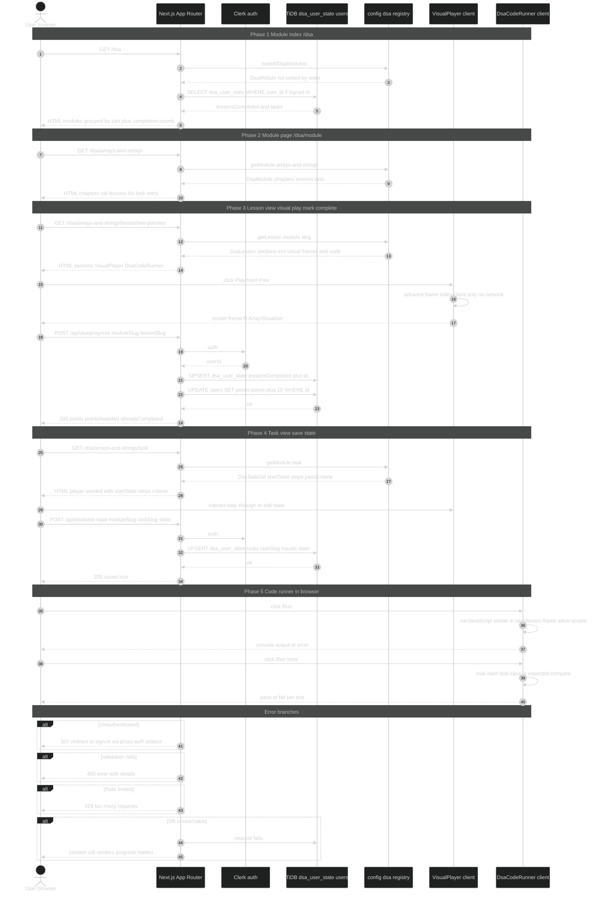

### DSA Learning Module — interactive data structures & algorithms

**Key files**: `config/dsa/types.ts`, `config/dsa/registry.ts`, `config/dsa/modules/*.ts`, `config/schema.tsx` (`dsaUserState`), `lib/dsa-data.ts`, `app/api/dsa/progress/route.ts`, `app/api/dsa/task-state/route.ts`, `app/(routes)/dsa/page.tsx`, `app/(routes)/dsa/[module]/page.tsx`, `app/(routes)/dsa/[module]/lesson/[slug]/page.tsx`, `app/(routes)/dsa/[module]/task/page.tsx`, `components/dsa/VisualPlayer.tsx`, `components/dsa/visualizers/*Visualizer.tsx`, `components/dsa/DsaCodeRunner.tsx`, `app/(routes)/_components/Sidebar.tsx`, `lib/dsa/content-rules.ts`, `scripts/check-dsa.ts`.

**Step-by-step actions**:

1. **Index load** — Server Component calls `loadAllDsaModules()` (config-only, no DB), groups by `part`, fetches `dsa_user_state` only if signed in (try/catch → empty on failure). Returns HTML with completion counts.
2. **Module load** — `getModule(slug)` (prototype-chain guarded). Renders chapters rail (left) + lessons list + task entry when `kind === "lesson+task"`. Content never touches DB.
3. **Lesson load** — `getLesson(module, slug)`. Sections render top-to-bottom: `scenario`/`concept` (HTML), `visual` → `<VisualPlayer frames>` (client, frame index state only, no network), `code` → `<DsaCodeRunner>` (Monaco + in-browser runner), `your_turn`/`compare`/`recap`/`video`.
4. **Visual play** — pure client state: Prev/Next/Play/Pause/Reset + speed. Auto-advance via cleared `setTimeout`. Keyboard ←/→/Space. Renderers are dumb (frame state → SVG/divs). No server round-trip.
5. **Mark complete** — `POST /api/dsa/progress` → Zod validate `{moduleSlug, lessonSlug}` → Clerk `auth()` → rate limit 10/min → `markLessonComplete` upserts `dsa_user_state.lessonsCompleted` and increments `users.points` by 10 (idempotent: re-post returns `alreadyCompleted`, no double award) → returns `{points, pointsAwarded, alreadyCompleted}`.
6. **Task load** — `/dsa/[module]/task` renders player seeded with `task.startState`, a steps list (hint → reveal ladder), and pass criteria.
7. **Task save** — `POST /api/dsa/task-state` → validate → auth → rate limit → upsert `dsa_user_state.tasks[taskSlug]` (graph-less JSON per task) → returns `{saved: true}`. Saves only on explicit action (no autosave storm).
8. **Code run** — `runJavaScript`/`runTypeScript` from `lib/editor` in a sandboxed iframe (`sandbox="allow-scripts"`). "Run tests" evals each `{input, expected}` and reports pass/fail per test.
9. **Error branches** — unauthenticated → 307 to `/sign-in` (proxy.ts); Zod failure → 400; rate limit → 429; DB down → content still renders (config-driven), progress hidden.

**Data flow**:
- Content flows one way: `config/dsa/modules/*.ts` → registry → Server Components → HTML. No DB involved for content.
- Progress flows: browser → `/api/dsa/*` → `dsa_user_state` + `users.points` → read back on next index/module load.
- Visuals and code execution are entirely client-side; only completion/state crosses the network.

**Assumptions**:
- DSA code is JavaScript/TypeScript only in v1 (Python/C++ deferred; no serverless runner).
- Visual animations are hand-authored frame arrays, not computed — animation "intelligence" lives in content, not an engine.
- `dsa_user_state` is one row per Clerk user (mirrors `sd_user_state`); no per-module rows.
- Points award value (10/lesson) is a placeholder to be confirmed against the existing points economy.
- `check:dsa` is added to `package.json` and wired into CI after `Build` by the CI owner (not done by this plan's code tasks).
- Sidebar entry + sitemap updates are part of Task 10, not this diagram.

---

### Diagrams missing from `diagrams/` (implemented-but-undocumented features)

Cross-referencing `.agent/feature-tracker.md` against `diagrams/01..27`:

| Feature | Tracker status | Diagram? |
|---|---|---|
| 1.5 Course content (Restart) | Restart | Covered by `02-course-catalog-chapters` (partial) |
| 2.10 Question bank expansion | Done | ❌ missing |
| 2.14 Route refresh fix | Done | ❌ missing |
| 3.1 Community posts | Pending (not implemented) | n/a |
| 3.2 Comment system | Pending | n/a |
| 3.4 Developer notebook | Pending | n/a |
| 4.3 Challenge arena | Pending | n/a |
| 4.4 Resume analyzer | Pending | n/a |
| 4.5 Notifications | Pending | n/a |
| 5.7 Skills roadmap tree | Pending | n/a |
| 5.8 YouTube video courses | Pending | n/a |
| 5.9 Roadmaps module | In Progress | ❌ missing (tasks 1–4 done) |
| 6.1 System design (B8+ content slices) | In Progress | Covered by `22`/`26`/`27` (partial) |

Pending features cannot be diagrammed faithfully (not implemented). The two highest-value gaps to close once their code lands: **Roadmaps module** (5.9) and **Question bank expansion** (2.10). The DSA diagram above is `28-dsa-module.md`.