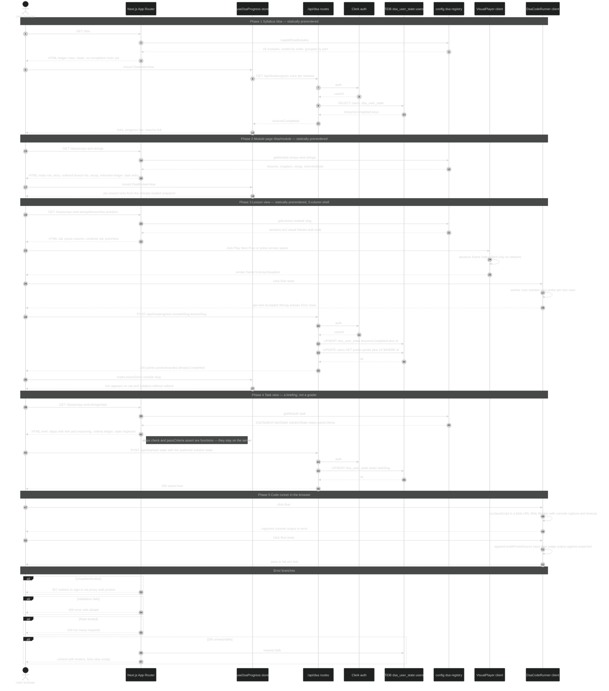

### DSA Learning Module — interactive data structures & algorithms

**Key files**: `config/dsa/types.ts`, `config/dsa/registry.ts`, `config/dsa/modules/*.ts`, `config/schema.tsx` (`dsaUserState`), `lib/dsa-data.ts`, `lib/dsa/view-model.ts`, `lib/dsa/judge.ts`, `hooks/useDsaProgress.ts`, `app/api/dsa/progress/route.ts`, `app/api/dsa/task-state/route.ts`, `app/(routes)/dsa/page.tsx`, `app/(routes)/dsa/[module]/page.tsx`, `app/(routes)/dsa/[module]/lesson/[slug]/page.tsx`, `app/(routes)/dsa/[module]/task/page.tsx`, `components/dsa/DsaIndexView.tsx`, `components/dsa/DsaModuleView.tsx`, `components/dsa/DsaLessonView.tsx`, `components/dsa/DsaTaskView.tsx`, `components/dsa/PracticePanel.tsx`, `components/dsa/VisualPlayer.tsx`, `components/dsa/visualizers/*Visualizer.tsx`, `components/dsa/DsaCodeRunner.tsx`, `app/(routes)/_components/Sidebar.tsx`, `lib/dsa/content-rules.ts`, `scripts/check-dsa.ts`.

**Step-by-step actions**:

1. **Syllabus load** — Server Component calls `loadAllDsaModules()` (config-only, no DB), maps each to a `DsaModuleOverview` and groups rows by `part`. The page is fully static: completion state arrives from the client store, not from the render.
2. **Progress read** — `useCompletedLessons()` (`useSyncExternalStore`) fires one `GET /api/dsa/progress` per session. The handler authenticates, applies a per-instance memory limit, resolves Clerk → DB user, and returns `{ lessonsCompleted }`. Signed-out requests fail silently; the syllabus still renders, just without ticks. This is what keeps 18 routes static instead of per-user.
3. **Module load** — `getModule(slug)` (prototype-chain guarded). Renders one ordered lesson list (`lessonOrder`, chapter leaves when authored), the module `story`, `recap`, the `interviewByte` ledger, and a task entry when `kind === "lesson+task"`. Content never touches DB.
4. **Lesson load** — `getLesson(module, slug)`. A viewport-height three-column shell owns its own scroll (`AppShell`'s `main` is `overflow-hidden`, so `position: sticky` cannot work inside it). Sections render top-to-bottom: `scenario`/`concept` (prose), `visual` → `<VisualPlayer frames>`, `code` → `<DsaCodeRunner>`, `your_turn`/`compare`/`recap`/`video`. Completion is seeded from the store, so a finished lesson looks finished on the next visit.
5. **Visual play** — pure client state: Prev/Next/Play/Pause + speed, per-frame timeline, keyboard ←/→/Space. Renderers are dumb (frame state → divs/SVG). No server round-trip.
6. **Code run** — `runJavaScript`/`runTypeScript` from `lib/editor` execute in a blob-URL Web Worker with captured `console`, a timeout, and shadowed network globals. "Run tests" appends `buildProbeSource(input)` (direct `eval` + `JSON.stringify` behind a marker) and compares with `judge()`, which normalises the authored `expected` string the same way. Per-test verdicts, not a text dump.
7. **Mark complete** — `POST /api/dsa/progress` → Zod validate `{moduleSlug, lessonSlug}` → Clerk `auth()` → DB-backed rate limit 10/min → `markLessonComplete` upserts `dsa_user_state.lessons_completed` and increments `users.points` by 10 (idempotent: a re-post returns `alreadyCompleted`, no double award) → returns `{points, pointsAwarded, alreadyCompleted}`. The store then unions the key locally, so the tick appears without a refetch.
8. **Task load** — `/dsa/[module]/task` is a briefing. `steps[].check` and `passCriteria[].assert` are functions and cannot cross into a Client Component, so the page shows the break, the procedure (hint/reasoning disclosures), the criteria as a ledger with advisory ones marked, and a read-only `startState` / `solutionState` inspector. Nothing is presented as a measured pass.
9. **Task save** — "Mark task done" posts the authored `solutionState` to `/api/dsa/task-state` (validate → auth → rate limit → upsert `dsa_user_state.tasks[taskSlug]`) and returns `{saved: true}`. No autosave.
10. **Error branches** — unauthenticated → 307 to `/sign-in` (proxy.ts); Zod failure → 400; rate limit → 429; DB down → content still renders, ticks stay empty.

**Data flow**:

- Content flows one way: `config/dsa/modules/*.ts` → registry → Server Components → HTML. No DB involved for content, and no DB in the render path for any DSA page.
- Progress flows: browser store → `/api/dsa/*` → `dsa_user_state` + `users.points` → back into the store, which every DSA surface reads.
- Visuals and code execution are entirely client-side; only completion and task state cross the network.

**Assumptions**:

- DSA code is JavaScript/TypeScript only in v1 (Python/C++ deferred; no serverless runner).
- Visual animations are hand-authored frame arrays, not computed — animation "intelligence" lives in content, not an engine.
- `dsa_user_state` is one row per DB user (mirrors `sd_user_state`); lessons are a JSON key list, tasks a JSON map. No per-lesson rows.
- Points award value (10/lesson) is a placeholder to be confirmed against the existing points economy.
- The task page cannot grade a learner: the authored checks are server-side functions. It records completion and shows the data shape instead.
- `part` is a 0-based grouping key in content; every surface displays `part + 1`.
- The app shell hardcodes `bg-[#05060a]` (`AppShell`), so `next-themes`' light theme is not reachable app-wide. `.cp-scope` still defines light tokens so the module is correct the day that is fixed.

---

### Diagrams missing from `diagrams/` (implemented-but-undocumented features)

Cross-referencing `.agent/feature-tracker.md` against `diagrams/01..27`:

| Feature                                | Tracker status            | Diagram?                                          |
| -------------------------------------- | ------------------------- | ------------------------------------------------- |
| 1.5 Course content (Restart)           | Restart                   | Covered by `02-course-catalog-chapters` (partial) |
| 2.10 Question bank expansion           | Done                      | ❌ missing                                        |
| 2.14 Route refresh fix                 | Done                      | ❌ missing                                        |
| 3.1 Community posts                    | Pending (not implemented) | n/a                                               |
| 3.2 Comment system                     | Pending                   | n/a                                               |
| 3.4 Developer notebook                 | Pending                   | n/a                                               |
| 4.3 Challenge arena                    | Pending                   | n/a                                               |
| 4.4 Resume analyzer                    | Pending                   | n/a                                               |
| 4.5 Notifications                      | Pending                   | n/a                                               |
| 5.7 Skills roadmap tree                | Pending                   | n/a                                               |
| 5.8 YouTube video courses              | Pending                   | n/a                                               |
| 5.9 Roadmaps module                    | In Progress               | ❌ missing (tasks 1–4 done)                       |
| 6.1 System design (B8+ content slices) | In Progress               | Covered by `22`/`26`/`27` (partial)               |

Pending features cannot be diagrammed faithfully (not implemented). The two highest-value gaps to close once their code lands: **Roadmaps module** (5.9) and **Question bank expansion** (2.10). The DSA diagram above is `28-dsa-module.md`.
